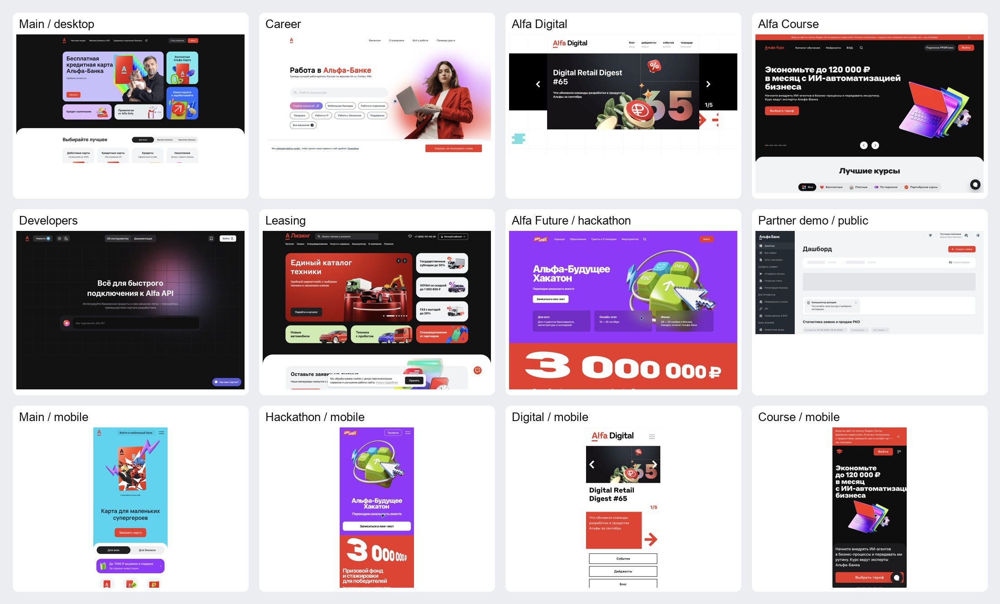

# Визуальный стиль сайтов Альфа Банка и инструкции для SYNAPTIX

Срез публичных интерфейсов на **20 октября 2026 года**. Документ предназначен для дизайнера и разработчиков SYNAPTIX: он объясняет визуальные системы экосистемы, содержит измеренные параметры и задаёт практический способ их применения в кредитном веб-кабинете.

У экосистемы несколько визуальных систем. Общие признаки — красный акцент, сильная типографика, контрастные поверхности, крупные предметные иллюстрации и ясная иерархия действий. При этом основной сайт, Альфа-Будущее, Alfa Digital, ипотека и партнёрский кабинет используют разные шрифты, радиусы, плотность и компоновку. Выбирать нужно целостный образец для конкретной задачи.

Это исследовательское руководство команды, а не официальный брендбук банка. Для каждой группы чисел ниже указан вид основания:

- **Замер** — значение из DOM, computed CSS или загруженного stylesheet конкретной страницы.
- **Публичный токен** — определение из открытого репозитория дизайн-системы; его наличие не доказывает использование на каждом сайте.
- **Наблюдение** — приём, видимый на скриншоте или в официальном обзоре.
- **Правило SYNAPTIX** — предлагаемое решение для нашего прототипа, которое ещё предстоит реализовать и проверить.

## Как пользоваться руководством

1. Для кабинета начать с разделов о формах, партнёрском демо и правилах SYNAPTIX.
2. Для внешнего продуктового лендинга использовать основной сайт и бизнес-направления.
3. Для промо хакатона или студенческого проекта использовать Альфа-Будущее.
4. Для редакционного или технического раздела сверяться с Alfa Digital и порталом разработчиков.
5. Перед точным воспроизведением открыть запись страницы в приложении с замерами: одинаковое название компонента не означает одинаковую реализацию.

Основные приложения:

| Материал | Назначение |
| --- | --- |
| [Измерения страниц](research/alfa-2026-10-20/measurements.json) | Шрифты, цвета, прямоугольники, элементы управления, карточки и CSS-сигналы |
| [Дополнительные страницы](research/alfa-2026-10-20/extended-measurements.json) | Молодёжные разделы, мобильные профили, документация и официальные обзоры |
| [Публичные токены](research/alfa-2026-10-20/official-design-tokens.json) | Каталог определений с источниками и контрольными суммами |
| [CSS основного сайта](research/alfa-2026-10-20/home-css-details.json) | Радиусы, отступы, hover-правила, анимации, media queries и font-face |
| [Состояния поля ипотеки](research/alfa-2026-10-20/mortgage-field-states.json) | Обычное поле, фокус, заполнение и восстановленное пустое состояние |
| [Таблицы кабинета](research/alfa-2026-10-20/partner-table-styles.json) | Размеры, типографика, отступы таблицы и SVG |
| [Реестр покрытия](research/alfa-2026-10-20/coverage.csv) | Проверенные адреса и найденные адреса, которые ещё не обследованы |
| [Снимки экранов](research/alfa-2026-10-20/screenshots/) | Публичные визуальные образцы; фотографии и графика принадлежат их правообладателям |

## Покрытие и границы

Проверены страницы из исходных вкладок Chrome и связанные разделы в тех же вкладках. Новые вкладки для исследования не создавались. Сохранены **119 наблюдений для 76 разных URL и 60 скриншотов**. В публичной [карте основного сайта](https://alfabank.ru/sitemap/) найдено **1 413 уникальных адресов** до нормализации редиректов и повторяющихся слешей. Этот список сохранён полностью, но он не равен числу обследованных страниц.

В исследование вошли розничные и бизнес-продукты, молодёжная экосистема, хакатон, кампус, стажировки, гранты, магистратуры, курсы, карьера, Alfa Digital, Альфа-Курс, разработчики, лизинг, CPA-программа, доступные формы и публичное демо партнёрского кабинета. Из карты основного сайта последовательно проверены все найденные ссылки раздела Альфа-Будущего; редиректы отражены в реестре. Региональные, архивные, SEO-варианты продуктов и все вложенные статьи не объявляются полностью обследованными.

| Исходная страница | Что доступно для исследования |
| --- | --- |
| [Основной сайт](https://alfabank.ru/) | Десктопный документ и отдельная мобильная компоновка |
| [Карьера](https://job.alfabank.ru/) | Публичная главная, навигация, поиск и карточки |
| [Alfa Digital](https://digital.alfabank.ru/) | Главная, сведения о команде, официальные обзоры продуктов |
| [Альфа-Курс](https://kurs.alfabank.ru/) | Публичная витрина и начальное модальное окно входа |
| [Онлайн-банк](https://online.alfabank.ru/) | Во время проверки — ошибка upstream connection; интерфейс изучен по официальным обзорам |
| [Альфа ID](https://id.alfabank.ru/) | В существующей вкладке — состояние «Не получилось войти» |
| [Инвестиционная анкета](https://alfabank.ru/make-money/investments/anketa/terminal/) | Первый шаг из трёх, поля, альтернативный вход через Госуслуги |
| [Портал разработчиков](https://developers.alfabank.ru/) | Главная, светлая и тёмная темы, публичная документация |
| [Ипотека](https://ipoteka.alfabank.ru/predecision/contacts) | Контактная форма, список восьми шагов, справка, адаптивная компоновка |
| [Альфапартнерс](https://alfapartners.alfabank.ru/) | Публичная CPA-витрина, регистрационный блок, калькулятор, FAQ |
| [Кабинет партнёра](https://partner.alfabank.ru/redesign/login) | Вход, публичный демо-дашборд, заявки, сотрудники, FAQ и ограничение доступа к договорам |
| [Альфа-Лизинг](https://alfaleasing.ru/) | Публичная главная, каталог, фильтры и калькулятор |

Номера телефонов пользователя, значения контактных полей, cookies, токены входа и содержимое личных банковских счетов в материалы не включались. Для проверки поля использовалось вымышленное имя; ввод удалён. Согласия, договоры, заявки, операции со счетами и регистрация не подтверждались. В демо банка источник сам обозначает компанию как тестовую; её содержимое не является реальным клиентским исследованием.

## Карта визуальных систем

| Семейство | Основной характер | Типографика | Геометрия |
| --- | --- | --- | --- |
| Розничный сайт и SME | Контрастная витрина, пастельные плитки, предметная 3D-графика | Alfa Interface Sans | Карточки 24–32 px, крупные края секций до 64 px |
| Альфа-Будущее | Плакатная подача, насыщенные фоны, коллажи, крупные цифры | Styrene A LC Web в заголовках, Alfa Interface Sans в интерфейсе | Частые карточки 12 px; на телефонах встречаются 8 px |
| Alfa Digital | Редакционная сетка, чёрное и белое, красные вставки, стрелки | Styrene UI | У главной преобладают прямые углы |
| Альфа-Курс | Тёмный промо-экран, тяжёлые заголовки, округлые светлые секции | Styrene A LC Black и Medium, Alfa Interface Sans | Карточки 24 → 16 px, края секций 48 → 32 px |
| Ипотека | Спокойная анкета, прогресс, светлый фон, функциональная иерархия | Системный стек | Поля 8 px на десктопе, чёрная кнопка 12 px |
| Партнёрский кабинет | Рабочая плотность, боковая навигация, таблицы и фильтры | Системный стек; отдельные Styrene UI заголовки | Контейнеры 8–16 px, кнопки 10–12 px |
| Разработчики | Видимая сетка, нейтральные темы, цветное свечение | Alfa Interface Sans и системный стек | Контролы 10–12 px, поисковая панель 24 px |
| Лизинг | Тёмная витрина, предметная графика, насыщенный каталог | Системный стек и Styrene UI | Промо 32 px, небольшие контролы 8–12 px |

Для SYNAPTIX базовый образец — функциональный кабинет с компонентами форм; внешний промо-экран может использовать геометрию продуктового сайта. Молодёжную плакатную подачу стоит оставить для описания проекта или мероприятия.

## Цвета

### Брендовая палитра из публичных токенов

Источник — [colors-brand.css](https://github.com/core-ds/core-components/blob/master/packages/vars/src/colors-brand.css). Это отдельная публичная палитра; она не заменяет семантические цвета поверхности и текста.

| Имя токена | Значение | Практическая роль |
| --- | --- | --- |
| `--color-static-brand-red` | `#ef3124` | Бренд, основное действие в розничных промо |
| `--color-static-brand-black` | `#000000` | Контрастный промо-фон, типографика |
| `--color-static-brand-white` | `#ffffff` | Светлые поверхности и контрастный текст |
| `--color-static-brand-blue` | `#0056ff` | Брендовый дополнительный синий |
| `--color-static-brand-bright-blue` | `#00e8f0` | Яркий голубой в промо |
| `--color-static-brand-green` | `#31e300` | Яркий зелёный в промо |
| `--color-static-brand-violet` | `#6a4dff` | Фиолетовый акцент |
| `--color-static-brand-warm-green` | `#a8f000` | Тёплый лаймовый акцент |

В `colors-students.css` дополнительно определены `#8fff00` и `#fe34c6`. На реальных молодёжных страницах есть и другие проектные цвета: например, замер карточек курса Android показал `rgb(168,255,0)`, а образовательной витрины — `rgb(38,111,255)`. Не сводить все лаймовые и синие оттенки экосистемы к одному HEX.

### Измеренные нейтральные цвета

| Контекст | Значение | Где наблюдалось |
| --- | --- | --- |
| Основной текст светлой темы | `rgba(3,3,6,.88)` | Основной сайт, формы, кабинет |
| Вторичный текст светлой темы | `rgba(4,4,21,.47)` либо `rgba(4,4,19,.55)` | Разные поколения компонентов |
| Основной текст на тёмном фоне | `rgba(255,255,255,.94)` | Основной сайт, разработчики |
| Вторичный текст на тёмном фоне | `rgba(238,238,251,.55)` | Тёмные интерфейсные поверхности |
| Светлый фон секции | `#f2f3f5` | Розничные страницы, Альфа-Курс, кабинет |
| Тёмная поверхность | `#121213`, `#212124` | Разработчики, кнопки, тёмные блоки |
| Фон промо Альфа-Курса | `#0e0e0e` | Верхняя секция |
| Светлая поверхность Альфа-Курса | `#fdfcfc` | Карточки и круглые переключатели |
| Обычное поле формы | `rgba(15,25,55,.10)` | Ипотека и компоненты кабинетов |
| Мягкая заливка карточки | `rgba(38,55,88,.06)` | Светлые продуктовые преимущества |
| Прогресс ипотеки | `#0cc44d` | Активная часть шкалы первого шага |
| Светло-зелёная панель входа партнёра | `#d6ffe7` | Правая половина login-экрана |
| Предупреждение в демо | `#ffefd9` | Ограничение доступа к договорам |

Альфа-канал — часть значения. Один и тот же полупрозрачный цвет на белом и сером фоне выглядит по-разному. Не заменять его подобранным по JPEG непрозрачным цветом. Цвета брать из CSS: скриншоты проходят через цветовой профиль и сжатие.

### Пастельные и промо-поверхности

Замеры основной витрины и SME показывают сиреневые, бирюзовые, голубые, персиковые и зелёные карточки. Примеры: `#dfbfff`, `#fcb1a7`, `#bff0a8`, `#ffe5c7`, `#accefe`. На CPA-витрине встречаются `#ffecd5`, `#eae6fc`, `#f1f1f1`.

Красный не обязан занимать весь экран. На светлой продуктовой странице он выделяет главное действие; на ярком фиолетовом лендинге хакатона действие может быть белым; в ипотечной анкете основная кнопка чёрная. Цвет действия выбирать в контексте контраста и семейства интерфейса.

### Семантические палитры и инфографика

В публичном каталоге выделены семейства `colors-pfm`, `colors-qualitative`, `colors-sequential`, `colors-decorative`, `colors-promo`, `colors-superapp`, а также отдельные тёмные варианты. Их определения находятся в приложении с токенами.

Примеры PFM-цветов категорий: синий `#71a5f2`, голубой `#51b1d7`, индиго `#9b95f2`, зелёный `#40ba93`, розовый `#f8789e`, оранжевый `#f29b3e`, фиолетовый `#d086ec`, красный `#ec5742`, жёлтый `#f6d53d`. Это фактические публичные значения, но привязка конкретной категории расходов к цвету не установлена.

Правило SYNAPTIX: статус решения, серия графика и декоративный фон должны иметь разные семантические роли. Сохранять подпись статуса рядом с цветом; назначение цвета не должно определяться только его похожестью на фирменный красный.

## Шрифты и типографика

### Семейства

| Семейство | Проверенное применение | Деталь |
| --- | --- | --- |
| Alfa Interface Sans | Основной сайт, продукты, SME, молодёжный интерфейс, Альфа ID | Основной сайт загружает веса 400, 500, 700 в WOFF2 |
| Styrene A LC Web | Крупные заголовки Альфа-Будущего | Плотный плакатный набор, часто line-height 0.9 |
| Styrene UI | Главная Alfa Digital, отдельные заголовки кабинетов, лизинг | В CSS присутствуют веса 400, 500, 700 |
| Styrene A LC Black | Крупные заголовки Альфа-Курса | Отдельный font-face с собственными метриками |
| Styrene A LC Medium | Текст и отдельные компоненты Альфа-Курса | Не подменять автоматически названием Styrene UI |
| Segoe UI | Карьерный сайт | Сайт сам объявляет webfont-файлы Segoe UI; это не только системный fallback Windows |
| Системный стек | Ипотека, партнёрский кабинет и часть лизинга | `system-ui`, `-apple-system`, Segoe UI, Roboto, Helvetica и др. |
| Roboto Rouble, kurs, swiper-icons | Служебные начертания и иконки | Их наличие не означает использование в обычном тексте |

Computed `font-family` показывает CSS-стек, а не гарантированно выбранный браузером файл. Частота `Times` в некоторых контейнерах Альфа-Курса не означает, что сайт оформлен антиквой: видимый текст внутри использует собственные классы и шрифты.

Публичные [typography-vars.css](https://github.com/core-ds/core-components/blob/master/packages/vars/src/typography-vars.css) определяют три отдельных стека: system, styrene и alfasans. Файлы шрифтов в репозиторий SYNAPTIX не добавлены. При реализации использовать согласованные права на конкретные файлы; до этого обеспечить системный fallback и проверить переносы строк.

### Измеренные размеры

Формат — `font-size / line-height`, в CSS px.

| Элемент | Широкий экран | Телефон или узкий вариант | Основание |
| --- | --- | --- | --- |
| Продуктовый H1 | 48 / 52 | Обычно 30 / 36 | Кредит, молодёжь, корпоративная витрина |
| Продуктовый H2 | 40 / 48 | 26 / 32 | Розничные и бизнес-страницы |
| Подзаголовок карточки | 22 / 26 или 30 / 36 | 20 / 28 в отдельных блоках | Главная, Alfa Only |
| Хакатон H1 | 64 / 57.6 | 34 / 30.6 | Styrene A LC Web |
| Хакатон H2 | 40 / 36 | 30 / 27 | Тот же лендинг |
| Стажировка H1 | 80 / 72 | 48 / 43.2 | Отдельный вариант молодёжной страницы |
| Кампус H1 | 80 / 72 | 34 / 30.6 | Альфа Кампус Старт |
| Экскурсии и креаторы H1 | 96 / 86.4 | Не фиксировалось как универсальное правило | Десктопные страницы |
| Магистратуры H1 | 48 / 43.2 либо 64 / 57.6 | Зависит от страницы | Несколько разных программ |
| Alfa Digital, заголовок слайда | 51 / 60 | Мобильный документ меняет композицию | Главная Digital |
| Карьера H2 | 40 / 52 | 28 / 32 | job.alfabank.ru |
| Альфа-Курс H2 промо | 52 / 54 | 36 / 36 при 390 px; 34 / 40 при 768 px | Ширины проверены отдельно |
| Разработчики H1 | 48 / 64 | 30 / 36 при 390 px; 40 / 48 при 768 px | Публичная главная |
| Демо-кабинет H1 | 40 / 48 | 30 / 36 | Партнёрский дашборд |
| Ошибка Альфа ID | 22 / 26 | 20 / 28 | Только доступное состояние ошибки |
| Поле ипотеки | 16 / 20 | 16 / 20 | Измеренное поле фамилии |

Размеры не обязаны монотонно возрастать с шириной: у Альфа-Курса телефонный и планшетный промо-шаблоны различаются. Не выводить всю адаптивную шкалу из одного H1.

### Набор текста

В интерфейсах часто используются короткие заголовки, крупное числовое обещание, отдельная поясняющая строка и глагол на кнопке. Встречаются неразрывные пробелы в денежных суммах и устойчивых сочетаниях, знак рубля, длинное тире и русские кавычки.

Правило SYNAPTIX: суммы и даты форматировать единообразно; для сравниваемых сумм использовать табличные цифры, если шрифт их поддерживает. Плотный line-height 0.9 применять только к проверенным промо-заголовкам: многострочный текст анкеты и ошибки должны оставаться свободно читаемыми.

## Сетки и отступы

### Основной сайт

На десктопных продуктовых страницах измерен контентный контейнер **1140 px**. При ширине 1440 px его левый край — 150 px; при 1920 px — 390 px. На витрине встречается раскладка `849 + 24 + 267 px`, а в двухколоночных блоках — `558 + 24 + 558 px`. Для четырёх колонок используются карточки по 267 px с промежутками 24 px, для трёх — по 364 px.

У карточек часто внутреннее поле 24 или 32 px. Верхний отступ контентной секции нередко 72 px. Есть секции с padding `72px 0 0` и радиусом верхних углов 64 px.

Это параметры конкретных десктопных шаблонов. У А-Клуба есть более широкий верхний контейнер 1280 px. Карьерный сайт при наблюдаемой ширине 1512 px использовал контент 1152 px и карточки 273 px с промежутком 20 px.

### Мобильные страницы

Мобильный документ основного сайта использует другую навигацию и композицию. В измеренных формах и контентных карточках при 390 px встречается ширина **358 px**, то есть поля по 16 px. Промо-карусель главной может занимать **374 px**, то есть поля по 8 px. При 360 px аналогичная плитка имеет ширину 344 px.

Не вводить глобальное правило «все мобильные отступы 16 px». Витринная карусель, анкета, меню и полноширинная секция имеют разные контейнеры.

### Публичная шкала расстояний

Источник — [gaps.css](https://github.com/core-ds/core-components/blob/master/packages/vars/src/gaps.css):

`0, 2, 4, 6, 8, 10, 12, 16, 20, 24, 32, 40, 48, 56, 64, 72, 80, 96, 128 px`.

Есть отрицательные значения. Старые имена `--gap-xs`, `--gap-m`, `--gap-2xl` и т. п. помечены deprecated; числовые имена — актуальная форма в прочитанном источнике. Сетка не ограничивается шагом 8 px.

Правило SYNAPTIX: использовать семантические алиасы поверх ограниченной шкалы; расстояние между полями и между секциями назначать раздельно. Отступ должен выражать связь элементов, а не заполнять свободное место случайным числом.

## Скругления

Источник общей шкалы — [border-radius.css](https://github.com/core-ds/core-components/blob/master/packages/vars/src/border-radius.css).

| Радиус | Публичное определение или измеренное применение |
| --- | --- |
| 0 | Прямые углы Alfa Digital, текстовые и табличные контейнеры |
| 2, 4, 6 | Мелкие элементы, старые контролы, CPA-кнопка 6 px |
| 8 | Поле ипотеки на десктопе, таблицы кабинета, часть мобильных молодёжных карточек |
| 10 | Кнопки высотой 48 px в нескольких поколениях компонентов |
| 12 | Кнопки 56 px, молодёжные карточки, небольшие контейнеры кабинета |
| 14, 16, 20 | Дополнительные размеры, мобильные поля, уведомления и панели |
| 24 | Карточки преимуществ, поиск разработчиков, карточки Альфа-Курса на десктопе |
| 32 | Большие продуктовые карточки, верхние края мобильных секций |
| 36, 64 | Дополнительные публичные токены; 64 px реально встречается у крупных десктопных секций |
| 48 | Измеренный край секций Альфа-Курса; это не отдельный токен в прочитанной общей шкале |
| 99, 999, 50%, 100% | Пилюли и окружности; значения зависят от конкретного CSS |

Не применять `border-radius: 32px` ко всем компонентам. У большого белого контейнера, поля внутри него, маленькой метки и переключателя разные роли и размеры. Составные радиусы также важны: `64px 64px 0 0`, `32px 32px 0 0`, `0 0 32px 32px`, левый и правый сегменты общего элемента.

## Границы и тени

У основной продуктовой витрины большая часть видимых карточек отделяется заливкой и расстоянием; у обследованных базовых карточек `box-shadow: none`. В Alfa Digital границы и тонкие линии сетки — часть композиции. В рабочем кабинете тонкие разделители помогают читать таблицы и группы.

Не назначать всем белым карточкам одинаковую заметную тень. Тень нужна для слоя поверх другого содержимого: меню, всплывающей панели, модального окна. Красивое 3D-изображение на карточке не означает, что сама CSS-карточка имеет объёмную тень.

Измеренный фокус поля ипотеки: белая заливка и внутреннее кольцо `0 0 0 2px rgba(4,4,21,.47)`. Ширина и внешние размеры поля не меняются.

Публичные `shadows-superapp.css` содержат:

```css
/* Публичные значения; не доказательство применения к любой карточке */
--shadow-default:
  0 2px 8px rgba(0, 0, 0, .04),
  0 4px 40px 8px rgba(0, 0, 0, .024);
--shadow-promo: 0 4px 16px rgba(3, 3, 6, .08);
```

Для модального входа Альфа-Курса отдельно измерена многослойная тень с уровнями от 1 до 40 px. Не смешивать этот слой с плоскими карточками витрины.

## Компоненты интерфейса

### Кнопки и действия

В публичном `common.css` заданы высоты 32, 40, 48, 56, 64 и 72 px. На обследованных страницах реально встречаются 40 px в шапке, 48 px для обычного действия и 56 px для крупного действия анкеты. У карьерного сайта есть отдельная красная кнопка высотой 50 px и радиусом 4 px.

| Вариант | Наблюдаемое оформление | Где применять в SYNAPTIX |
| --- | --- | --- |
| Основной красный | `#ef3124`, светлый текст, часто 48/10 или 56/12 | Главное действие продуктовой страницы |
| Основной тёмный | `#212124`, светлый текст | Спокойная анкета и рабочий процесс |
| Вторичный | Полупрозрачная нейтральная заливка | Дополнительное действие рядом с основным |
| Белый на промо | Белая поверхность, тёмный текст | Яркий фон хакатона или чёрный промо-блок |
| Контурный | Прозрачная заливка, тонкая граница | Фильтры, отдельные подборки и редакционные ссылки |
| Только иконка | Компактный квадрат или круг | Дополнительное действие с доступным названием |

Ширина кнопки зависит от задачи. На мобильном хакатоне CTA занимает почти весь контентный контейнер; на мобильной главной отдельная кнопка заказа остаётся компактной. Не растягивать все действия автоматически и не делать весь экран одинаково акцентным.

### Поля и плавающие подписи

Поле фамилии в ипотеке измерено в четырёх состояниях:

| Свойство | Обычное | Фокус | Заполненное в фокусе |
| --- | --- | --- | --- |
| Высота оболочки | 56 px | 56 px | 56 px |
| Радиус оболочки | 8 px | 8 px | 8 px |
| Фон | `rgba(15,25,55,.10)` | Белый | Белый |
| Обводка | Нет | Внутреннее кольцо 2 px | То же |
| Текст | 16 / 20 | 16 / 20 | 16 / 20 |
| Padding самого input | `28px 12px 8px` | То же | То же |
| Переход оболочки | background и box-shadow 0.2 s | То же | То же |

Сама заливка находится на родительской оболочке, а не на `input`. Поэтому проверка только `getComputedStyle(input).backgroundColor` даст прозрачный фон и неверный вывод о компоненте.

На десктопе контактная форма ипотеки занимает около 700 px: ФИО расположены в три колонки, телефон и email — в две. На телефоне поля перестраиваются в одну колонку, контейнер имеет поля 16 px. У телефона проверено disabled-состояние; его значение не менялось.

Проверка вымышленного некорректного email при уходе из поля не вывела немедленную ошибку. Это не подтверждает отсутствие валидации: её поведение после отправки формы не исследовалось. Не переносить такой непроверенный вывод в реализацию.

### Прогресс и многошаговая форма

В ипотеке показаны «Шаг 1 из 8», сегментированная шкала и действие «Все шаги». Справочный список раскрывает путь:

1. Вход в личный кабинет.
2. Расчёт условий.
3. Анкета.
4. Документы.
5. Решение банка.
6. Проверка недвижимости.
7. Страхование.
8. Сделка.

Просмотр списка не означает прохождение этих экранов. После первого шага регистрация не выполнялась. В SYNAPTIX этот приём можно использовать для собственного процесса из согласованной диаграммы состояний; ипотечные этапы не подменяют требования нашего кейса.

### Вкладки и сегменты

Встречаются как минимум три разных решения: текстовые вкладки с красным подчёркиванием на экране входа партнёра; переключатель-пилюля на главной телефона; сегментированная панель на портале разработчиков. Активное состояние выражается заливкой, линией или контрастом текста, в зависимости от семейства.

Не смешивать разные решения внутри одной группы равноправных переключателей. В SYNAPTIX вкладки переключают представление, а кнопка следующего шага переводит процесс в новое состояние; эти действия должны различаться и по формулировке, и по поведению.

### Чекбоксы и согласия

У ипотеки обязательное согласие и рекламное согласие представлены отдельными чекбоксами; в CPA-регистрации также есть отдельные условия программы и ознакомление с политиками. Длинная подпись переносится в несколько строк и остаётся рядом с контролом. Встроенные ссылки подчёркнуты.

Правило SYNAPTIX: сохранять независимость разных согласий; имитацию подписи или согласия описывать явно в самом прототипе. При исследовании банковских форм согласия не включались.

### Модальные окна и мобильные панели

Ипотечная справка на телефоне открывается панелью с округлёнными верхними углами 16 px; доступен отдельный крестик. На широком экране используется центральный диалог. Проверены справка «Зачем нужен личный кабинет» и перечень шагов.

У Альфа-Курса окно входа при viewport 768 × 1024 имеет ширину 472 px, высоту 635 px, радиус 24 px и фон `#f2f3f5`. Внутри — одно поле «Почта или телефон», основное действие, Alfa ID и Alfa ID для бизнеса. Служебный `Times` у контейнера не определяет шрифт вложенного видимого текста. Окно было закрыто без ввода контактов.

Правило SYNAPTIX: диалог должен иметь заголовок, понятное закрытие, управление фокусом и возврат фокуса к инициатору. На телефоне критическая кнопка должна оставаться доступной при открытой клавиатуре. Это требования к нашему продукту, а не результат полного аудита доступности банка.

### Таблицы, фильтры и статусы

В публичном демо партнёрского кабинета при 1440 px наблюдались тёмная боковая панель шириной около 248 px, светлый рабочий фон и белые контейнеры. Контентная карточка имела ширину 1090 px; таблица внутри — 1058 px с внутренними боковыми полями.

Измеренные параметры таблицы дашборда:

- Заголовок столбца: 12 / 20 px, вес 500, letter-spacing 1.25 px.
- Padding заголовка: `32px 12px 4px 16px` у первого проверенного столбца.
- Текст проверенной ячейки статуса: 14 / 20 px.
- Padding ячейки: `24px 12px`.
- Высота проверенной строки с несколькими строками данных: 109 px; это результат содержимого, не универсальный токен высоты строки.
- Контейнеры списков: радиус 8 px; небольшие карточки и предупреждения — 12–16 px.

На экране заявок есть поиск, период, сотрудник, продукты, статус, тип заявки, количество результатов и пагинация. В демо ряд фильтров disabled. Не выдавать их визуальное наличие за проверенную функциональность.

Видимые статусы включают черновик, заполнение анкеты, работу, открытый счёт и отказ клиента. Для SYNAPTIX нужны собственные статусы из [state-machine.md](state-machine.md), с едиными названиями в клиентском и банковском интерфейсах.

В мобильном демо боковое меню скрывается, заголовок становится 30 / 36 px, действие создания — компактной иконкой, показатели перестраиваются в вертикальные строки. В наблюдаемом мобильном состоянии часть значений оставалась skeleton-заглушками; успешная загрузка этих данных не подтверждена.

### Состояния ошибки, запрета и загрузки

Ошибка Альфа ID оформлена как спокойный центрированный экран: служебная иконка, короткий заголовок, пояснение и кнопка повторной попытки. На телефоне заголовок 20 / 28 px. Это источник оформления ошибки, не образец доступного экрана ввода OTP.

В разделе договоров демо показано предупреждение с заливкой `#ffefd9` и радиусом 16 px: доступ ограничен ролью. Это хороший образец различения ошибки соединения и отсутствия прав.

Skeleton в мобильном демо — светло-серые полосы на месте значений. Для SYNAPTIX заглушка должна повторять будущую геометрию, иметь ограниченный сценарий ожидания и сменяться данными либо явной ошибкой. Постоянное мерцание без завершения не является готовым состоянием продукта.

## Иконки, иллюстрации и фотографии

### Функциональные иконки

Наблюдаются одноцветные SVG-иконки, залитые glyph-символы и контурные знаки для отдельных действий. Частые области SVG — 16 и 24 px, но реальные размеры каждой группы нужно брать из приложения с замерами. В исходниках библиотеки перечислены пакеты `@alfalab/icons-glyph` и `@alfalab/icons-glyph-26`.

Сохранять одно семейство и оптический вес внутри навигации. Не объявлять универсальную толщину stroke 2 px: многие иконки состоят из залитых контуров, а не stroke. Для кнопки только с иконкой задавать доступное название. В продуктовых рекламных материалах встречаются emoji, но это не правило для рабочего меню.

У Альфа-Курса присутствует собственный иконочный шрифт `kurs`, у слайдеров — `swiper-icons`. Не копировать видимый код символа из accessibility-выгрузки как обычный текст: без соответствующего font-face получится другой знак или пустой квадрат.

### Предметная графика

Общий наблюдаемый язык — крупные 3D-предметы с закруглёнными краями, красные банковские карты, монеты, стрелки, проценты, подарки и экраны устройств. Используются глянцевые, металлические, стеклянные и полупрозрачные материалы, мягкие тени и отражения. У молодёжных кампаний предметы ярче, встречаются пиксельные курсоры, клавиши и игровые мотивы. Alfa Only использует светлую перламутровую и стеклянную графику, А-Клуб — тёмные материалы и направленный свет.

Графика поддерживает смысл блока: на хакатоне клавиши и курсор, у инвестиций биржевые символы, у лизинга транспорт, у премиума знак бесконечности. Не размещать один и тот же абстрактный 3D-объект во всех карточках.

### Фото и коллажи

На карьерной странице человек отделён от фона и сочетается с мягким цветным свечением. На главной Альфа-Будущего фотография построена на сильной перспективе и динамической позе; типографический знак собран как отдельная плакатная графика. На розничной главной фотография и карточный предмет могут входить в одну композицию.

Для SYNAPTIX достаточно одной согласованной иллюстрации на вводном экране. В анкете, таблице заявок и принятии решения декоративная графика должна уступать место данным и действиям.

### Логотип

Использовать официальный исходный знак подходящего варианта, сохранять пропорции и контраст. Не воспроизводить логотип наборным символом A с нарисованной вручную чертой и не объявлять такой рисунок официальным активом.

Для кнопки партнёрского входа есть отдельное [официальное руководство Alfa ID](https://alfabank.ru/sme/guide-alfaid/): оно задаёт композицию знака с текстом, варианты и минимальный размер знака. Этот частный гайд не распространяется автоматически на всю типографику банка. Его рекомендации по SF Pro Text не отменяют замеры Alfa Interface Sans на основном сайте.

## Инфографика и представление чисел

Нужно различать рекламную цифру и аналитический график. Призовой фонд на лендинге хакатона — крупная графическая композиция; это не шаблон осей и подписей диаграммы. Публичные обзоры интернет-банка показывают операционные списки, продуктовые карточки и диаграммы погашения, но не позволяют измерить их закрытый CSS.

Правила SYNAPTIX для финансовой инфографики:

1. Подписывать сумму, валюту, период и единицу измерения рядом со значением.
2. Разделять тело кредита, проценты и общую стоимость; не выдавать декоративное кольцо за проверенный расчёт.
3. Для сравнения нескольких продуктов сохранять одинаковый формат чисел и шкал.
4. Назначать категориям устойчивые цвета из подходящей семантической палитры, оставляя красный бренду и значимым действиям.
5. Дублировать цвет текстом, легендой или формой маркера.
6. На телефоне выносить итог над деталями; длинную легенду переносить под график.
7. Раскрывать метод расчёта и показывать, что значения демонстрационные.

Эти правила являются проектным решением. Полная система графиков закрытых банковских приложений по доступным источникам не восстановлена.

## Анимации и переходы

В [извлечении банковского CSS](research/alfa-2026-10-20/home-css-details.json) сохранены объявления с источником каждого stylesheet. Наличие правила в загруженном bundle ещё не означает, что анимация проигрывалась в текущем состоянии.

| Наблюдаемое объявление | Роль или ограничение интерпретации |
| --- | --- |
| Цветовые переходы 0.2 s, `ease` | Кнопки, границы, текст и состояния поля |
| `transform 150ms ease-in-out`, `opacity 150ms ease-in-out` | Быстрые появления и изменения состояния |
| opacity 300 ms, transform 0.3–0.5 s | Слои и компоненты переходов; длительность зависит от класса |
| `transform .5s cubic-bezier(.09,.91,.18,.99)` | Отдельный выразительный переход, не общий easing всего банка |
| Анимации появления по 400 ms | Есть в загруженном CSS; применять только к соответствующему компоненту |
| Spinner 0.8 s, infinite linear | Служебная загрузка |
| Мигание loader 950 ms | В CSS есть сдвиги фаз 0, 150, 300 ms |
| `code-input__shake … .15s … 3` | Объявление встряхивания поля кода; реальный ввод кода не проверялся |
| Skeleton opacity/background | Заглушки до загрузки содержимого |
| Длительности 999999 s | Служебная обработка autofill; не использовать как UX-анимацию |

Визуально подтверждены смена слайдов, адаптивная перестройка, раскрытие модальных справок и переключение тем разработчиков. Задержки загрузки и начальные скрытые заголовки не считаются намеренным художественным эффектом без дополнительной проверки.

Правило SYNAPTIX: контролы реагируют быстро; состояние отправки имеет ясное завершение; движение не задерживает ввод. Для `prefers-reduced-motion` убрать декоративные циклы и большие перемещения. Этот media query найден, в частности, в CSS разработчиков; полноценный аудит его покрытия по всем сайтам не проводился.

## Адаптивность и метод проверки

### Разные документы для телефона и компьютера

У основного сайта после сужения уже загруженного десктопного документа до 390 px наблюдалось горизонтальное переполнение. Загрузка с мобильным user-agent при той же ширине дала другую DOM-композицию, другую навигацию и `scrollWidth = 390 px`. Аналогичное различие выявлено у Alfa Digital. Поэтому один screenshot узкого десктопного окна не является исследованием настоящей мобильной страницы.

Проверялись viewport и Android Chrome mobile user-agent. Это эмуляция CSS-размеров и профиля, а не испытание на физическом Android или iPhone. iOS Safari, экранная клавиатура, поворот реального устройства и все промежуточные размеры не проверялись.

### Проверенные диапазоны

| Ширина | Что проверялось |
| --- | --- |
| 360 px | Главная с мобильным документом |
| 390 px | Мобильные продуктовые и молодёжные шаблоны, сервисы, формы и демо |
| 428 px | Главная с мобильным документом |
| 600 px | Главная с уже загруженным мобильным документом |
| 768 px | Альфа-Курс, разработчики, главный мобильный документ |
| 1024 px | Суженный десктопный документ главной; наблюдалось переполнение до 1172 px |
| 1200, 1280 px | Десктопная главная; фактические размеры записаны в замерах |
| 1440 px | Основной размер широких замеров |
| 1512 px | Исходный фактический viewport ряда вкладок |
| 1920 px | Десктопная главная, тот же центральный контейнер 1140 px |

### Media queries из доступного CSS

У карьерного сайта встречаются 576, 768, 992, 1220 px и дополнительные локальные условия. У Альфа-Курса — 576, 768, 992, 1200, 1400, 1679 px. У компонентов ипотеки и кабинета — условия около 600 и 1024 px, дополнительные размеры 320, 360, 375, 412, 1280, 1440, 1920 px. У Alfa Digital — условия около 768, 980, 1200 px.

Наличие breakpoint в библиотечном CSS не означает, что вся страница меняет сетку на этой ширине. Для каждой пары «элемент — разрешение» сверять computed CSS и фактическую компоновку. Media queries сторонней CAPTCHA и страницы ошибки Chrome исключены из банковского CSS-приложения.

### Предлагаемая адаптивная схема SYNAPTIX

Это схема нашего прототипа, а не извлечённый закрытый контракт банка:

- Узкий экран: одна колонка, рабочие поля 16 px, формы и карточки на доступную ширину, меню в выдвижной панели.
- Средний экран: одна основная колонка формы, допускается сводка ниже или рядом при достаточной ширине.
- Широкий экран: боковая навигация, форма ограниченной ширины, отдельная колонка итогов или помощи.
- Таблица банка: сначала приоритетные столбцы; доступ к деталям сохраняется. Горизонтальная прокрутка таблицы не должна превращаться в переполнение всей страницы.
- Функции сохраняются на всех размерах; декоративные изображения можно переставлять и сокращать.

## Особенности направлений

### Основная витрина и бизнес-продукты

Крупные цветные карточки образуют неравномерную композицию. Внутри — один заголовок, короткое пояснение, предметная графика и один очевидный переход. У продуктовых страниц повторяется схема: hero, преимущества, калькулятор или условия, инструкция, подробности и FAQ. Тёмный и светлый фон могут чередоваться крупными секциями.

Кредитная страница и бизнес-кредит визуально родственны, но используют разные контентные обещания и варианты фона. В SYNAPTIX реальные ставки и суммы из рекламных страниц не подставлять в синтетическую модель кредита как актуальные условия банка.

### Альфа-Будущее и хакатон

У заголовков Styrene заметно плотнее строки, чем у основного сайта. Фоны могут быть красными, фиолетовыми, синими и лаймовыми; маленькие информационные карточки часто имеют полупрозрачную заливку, радиус 12 px и padding 32 px. На мобильном хакатоне проверены карточки шириной 358 px, радиусом 8 px и padding 16 px.

Лендинги разных программ используют общий язык, но размер H1 варьируется от 48 до 96 px на широком экране. Сохранять вариант конкретного направления. Логотип Альфа-Будущего — отдельная графическая композиция, не обычный заголовок, набранный тем же шрифтом.

На странице хакатона прочитаны и другие организационные сведения. Они не переносились в требования SYNAPTIX как подтверждённый дедлайн сдачи: назначение этого исследования — стилистика, а правила сдачи сверяются отдельно с владельцем и официальным регламентом.

### Alfa Digital

Видимая координатная сетка, вертикальные и горизонтальные линии, прямые углы и редакционная композиция отличают Digital от округлой продуктовой витрины. Небольшие хештеги сопровождают навигацию. В мобильном документе изображение слайда отделяется от крупного заголовка и цветного пояснения; ссылки на разделы превращаются в крупные контурные блоки.

Часть дайджестов использует встроенную Tilda-разметку внутри Next.js-оболочки. Их промо-типографику и анимацию нельзя автоматически считать компонентами банковского кабинета.

### Альфа-Курс

Тёмная обложка сменяется светлым каталогом с крупными округлёнными краями. Обложки курсов и предметная графика составляют значительную часть визуального языка. У карточек каталога радиус 24 px на десктопе и 16 px на телефоне; у внешней секции — 48 и 32 px соответственно.

Заголовки используют отдельные Styrene A LC Black/Medium. В записи шрифтов присутствуют переопределения метрик ascent, descent и line-gap; одной замены font-family недостаточно для точного совпадения вертикального ритма.

### Разработчики

Главная сочетает сетку, большой центрированный заголовок и поисковую панель со свечением. В тёмной теме поверхности нейтральные; свечение цветное и локальное. В светлой теме поисковая поверхность становится `#f2f3f5`. Навигация документации использует левую колонку, хлебные крошки, метки типа интеграции и оглавление справа.

Поиск и тестовые банковские API не запускались. Кнопки генерации ключей, подписи договора и реальные запросы не являются частью проверки визуального стиля.

### Партнёрский кабинет и ипотека

Это наиболее полезные источники для рабочего продукта: содержательные заголовки, компактные контролы, отдельная помощь, прогресс, таблицы, статусные состояния и сдержанные заливки. Яркая графика остаётся в промо-панелях, а основная работа происходит в чистом интерфейсе.

### Alfa Only и А-Клуб

Alfa Only использует светлые поверхности, перламутровую графику, воздух и крупные предметы. А-Клуб использует чёрный фон, тёмные материалы и более кинематографическую обложку. Оба направления существуют параллельно: «весь премиум должен быть тёмным» не соответствует наблюдаемым страницам. Это также согласуется с [официальным сообщением о ребрендинге Alfa Only](https://alfabank.ru/news/t/release/alfa-bank-obyavlyaet-o-rebrendinge-premialnogo-servisa-teper-eto-alfa-only/).

## Публичные сведения о разработке

### Что подтверждается для конкретных страниц

| Поверхность | Наблюдаемые признаки | Вывод и его предел |
| --- | --- | --- |
| alfabank.ru | Загружены `peer-vendor-react`, `react-dom`, `react-helmet`, `_loadable_component`, lodash, classnames; CSS и JS чанки на servicecdn `/assr/` | React-экосистема в клиентской поставке. Точные версии и весь серверный стек не определены |
| job.alfabank.ru | `#__next`, пути `/_next/static/`, framework, webpack, pages/_app | Next.js/React; поколение и версии не выводились из хешей |
| digital.alfabank.ru | Next.js-оболочка; отдельные материалы загружают Tilda и jQuery-ресурсы | Несколько технологий на одной поверхности; не «весь банк на Tilda» |
| developers.alfabank.ru | `#__next`, Next static chunks, CSS классы компонентов | Next.js/React-оболочка портала; внутренние API реализации не раскрыты |
| alfaleasing.ru | `/catalog-next/_next/static/` | Next.js-поставка обследованной витрины; другие части домена могут отличаться |
| kurs.alfabank.ru | DOM с `ng-version="20.3.16"`, `ng-server-context="ssr"`, runtime/polyfills/main bundles | Angular 20.3.16 указан в обследованном DOM; SSR-маркер не раскрывает весь backend |
| ipoteka.alfabank.ru | `react-app`, vendor/main, CSS классы form-control/input | Сильные признаки React и родственных Core Components; точный lock-файл не доступен |
| partner.alfabank.ru | vendor/main, `classic-without-react`, классы таблиц и контролов | Модульная клиентская поставка; имя одного bundle не доказывает отсутствие React во всём приложении |
| alfapartners.alfabank.ru | vendor manifest, vendor/big/app, swiper-компоненты и характерные адаптивные правила | Точные frontend/backend-фреймворки не установлены |
| id.alfabank.ru | `/oidc/login/`, vendor/main/logger, состояние ошибки | OIDC-ориентированный вход по публичным URL; закрытая архитектура авторизации не исследовалась |

DOM-признаки и URL скриптов сохранены в замерах. Содержимое cookies, localStorage, приватных runtime-store и сетевых payload пользователей не извлекалось.

### Официально названный стек команды

На [странице Alfa Digital о команде](https://digital.alfabank.ru/about) перечислены Node.js, React, Redux, C++, PostgreSQL, TypeScript и Python; отдельно названы Java и другие направления компетенций. Это сведения об организации разработки, а не доказательство применения каждого инструмента на каждом домене.

В индексируемом тексте [официальной вакансии React + Angular](https://job.alfabank.ru/vacancies/moskva/remote-job/glavnyii-frontend-razrabotchik-%28react-%2B-angular%29_38031) описан внутренний продукт со смешанными React- и Angular-модулями, сложными формами и REST-интеграцией. Доступная при проверке карточка той же вакансии № 38031 показывает сообщение о её закрытии; стек здесь приводится по индексированному описанию. Это дополнительный источник о разнообразии стеков, а не подтверждение архитектуры розничного интернет-банка.

В индексируемой [программе MoscowJS в Alfa Digital](https://digital.alfabank.ru/events/moscow_JS_67) перечислены Module Federation, single-spa, iframe, web components и webview. Полный ответ источника при сетевой проверке был недоступен из-за проверки сертификата. Это дополнительный материал о темах платформенной разработки; его нельзя использовать как полный перечень технологий любого кабинета.

### Открытая дизайн-система

Рабочая публичная точка для компонентов — [core-ds/core-components](https://github.com/core-ds/core-components), для примитивов — [core-ds/ui-primitives](https://github.com/core-ds/ui-primitives). Старые `alfa-laboratory/core-components` и `alfa-laboratory/arui-feather` доступны как архивные репозитории; их браузерные ограничения и инструкции сборки не следует принимать за текущий стандарт банка.

В прочитанном package.json Core Components присутствуют React, TypeScript, Storybook, Webpack, Rollup, PostCSS, CSS Modules, Jest, Testing Library, Playwright, ESLint, Stylelint, Prettier, Changesets и Yarn workspaces. Это инструменты разработки публичной библиотеки. Их точные диапазоны версий сохранены в [сведениях об исходниках](research/alfa-2026-10-20/public-source-metadata.json); они не являются установленными версиями production-сайтов.

У библиотеки MIT-лицензия. Права на фотографии, брендовые изображения и файлы шрифтов определяются отдельно; лицензия компонентов не превращает все материалы сайтов в свободные активы. В исследовательском наборе нет скачанных шрифтов и установленных банковских runtime-зависимостей.

### Подключённые внешние ресурсы

В DOM разных страниц наблюдались Яндекс.Метрика, Альфа-Метрика, Mail.ru counter, Varioqub, SmartCaptcha и рекламные скрипты. На Альфа-Курсе присутствуют ресурсы CloudPayments и Jivo; у лизинга — Calltouch, Mindbox и другие виджеты. Наличие тега подтверждает включение ресурса в клиентскую страницу, а не полноту контракта, успешную работу сервиса или его использование во всех продуктах.

SYNAPTIX не должен копировать эти интеграции ради визуального сходства. Его проверяемый Docker-прототип работает без платных и банковских API, с локальными имитациями согласно требованиям кейса.

### Что остаётся неизвестным

Полные backend-сервисы, инфраструктура развёртывания каждого домена, закрытые API, версии всех пакетов, внутренний Figma-файл, лицензии конкретных коммерческих шрифтов, все кабинеты после авторизации и все состояние-переходы по доступным страницам не восстанавливаются. Не подставлять распространённые в банках Java, Kafka, Kubernetes, Spring или конкретную базу данных в архитектуру отдельного продукта без источника, привязанного к этому продукту.

## Инструкции для реализации SYNAPTIX

### Предлагаемая визуальная основа для следующей реализации

Следующие значения — **предложение для нашего кабинета**, составленное из совместимых измеренных приёмов. Они не объявляют существующую реализацию и не меняют требования продукта.

```css
:root {
  --syn-font-ui: "Alfa Interface Sans", system-ui, -apple-system,
    "Segoe UI", Roboto, "Helvetica Neue", Arial, sans-serif;
  --syn-brand: #ef3124;
  --syn-text: rgba(3, 3, 6, .88);
  --syn-text-secondary: rgba(4, 4, 21, .47);
  --syn-page: #f2f3f5;
  --syn-surface: #fff;
  --syn-action-dark: #212124;
  --syn-field: rgba(15, 25, 55, .10);
  --syn-focus: rgba(4, 4, 21, .47);
  --syn-radius-control: 12px;
  --syn-radius-field: 8px;
  --syn-radius-panel: 16px;
  --syn-radius-promo: 32px;
  --syn-gap-field: 24px;
  --syn-gap-group: 32px;
  --syn-gap-section: 48px;
  --syn-motion-control: 200ms;
}
```

Названия `--syn-*` придуманы для проекта. Шрифт с этим именем в CSS заработает только при доступном согласованном font-face; fallback обязателен. Тёмную тему вводить отдельными семантическими токенами, а не инвертировать весь интерфейс фильтром.

### Клиентский путь

1. Главная кабинета объясняет доступные действия и состояние текущей заявки.
2. Выбор финансирования показывает сравнимые условия и понятную причину рекомендации; иллюстрация не заменяет расчёт.
3. Анкета ограниченной ширины группирует связанные поля; прогресс отображает реальный процесс SYNAPTIX.
4. Документы имеют состояние загрузки, проверки и ошибки; пользователь видит, что нужно исправить.
5. Экран результата различает одобрение, отказ, запрос уточнений и техническую ошибку.
6. История действий и следующий шаг находятся внутри продукта, без зависимости от настоящих SMS или email.

### Рабочее место банка

Использовать плотность демо-кабинета: боковая навигация, список заявок, поиск, фильтры, ясные статусы и отдельная карточка решения. Не переносить на таблицу гигантские заголовки хакатона и декоративные изображения каждого продукта.

Доступные действия должны соответствовать роли и состоянию заявки. Причина недоступности действия объясняется рядом с ним. Данные и история после перезапуска берутся из приложения, а не дорисовываются как статичная презентация.

### Что подготовить при внедрении

Обновить реализацию, lock-файлы и notices выбранных компонентов; при изменении поведения — контракты, runbook и тестовые доказательства. Сохранить Docker-запуск, web UI, только синтетические данные, локальные моки и открытые веса, если LLM действительно добавляется. Это руководство не обосновывает подключение живого банковского API.

### Проверка визуального результата

Это план будущей проверки SYNAPTIX, не заявление о пройденных тестах банка:

- Сверить 360, 390, 428, 768, 1024, 1440, 1920 px и промежуточные переносы.
- Проверить отдельную мобильную загрузку и изменение ширины уже открытой страницы.
- Проверить реальные iOS Safari и Android Chrome либо явно записать оставшееся ограничение.
- Сравнить шрифты после завершения загрузки, особенно переносы H1 и денежных сумм.
- Проверить focus, disabled, filled, invalid, loading, success, empty и error.
- Открыть длинную форму с экранной клавиатурой, пройти её клавишей Tab, проверить диалоги и возврат фокуса.
- Убедиться, что таблица не вызывает горизонтальную прокрутку всей страницы.
- Проверить reduced motion, контраст, подписи иконок и сообщения ошибок.
- Сохранить скриншоты конкретных состояний и результат сквозного сценария.

## Готовая инструкция для следующего агента

> Перед работой прочитай README, requirements и CONTRIBUTING, затем это руководство. Реализуй SYNAPTIX как рабочий кредитный веб-кабинет с визуальной основой функциональных форм и партнёрского демо Альфа-Банка. Используй светлый рабочий фон, белые панели, тёмный текст, один основной акцент, поля высотой 56 px, умеренные радиусы контролов и чёткую иерархию. Не объединяй плакатную типографику Альфа-Будущего, прямоугольную сетку Digital и формы ипотеки в один случайный UI. Для каждого спорного размера проверь URL, viewport и запись замера. Значения из открытых токенов не считай автоматически применёнными на всех сайтах. Подготовь состояния ввода, ошибок, загрузки и результата; обеспечь адаптивность и клавиатуру. Используй только синтетические данные и локальные имитации интеграций. Не копируй реальные клиентские данные, не добавляй платные или банковские API, не включай файлы шрифтов без согласованных прав. Работай через отдельную ветку и PR, сохраняя изменения команды. Проверяй приложение сквозным сценарием в Docker; зелёный CI репозитория сам по себе готовность продукта не доказывает.

## Источники для закрытых экранов

| Источник | Что он подтверждает |
| --- | --- |
| [Новый Альфа-Клик](https://digital.alfabank.ru/digest/retail/new-click) | Исторические изображения десктопного кабинета, левое меню, уведомления, платежи и продуктовые блоки |
| [Обновлённый Альфа-Онлайн](https://digital.alfabank.ru/digest/retail/new-alfa-online) | Публичное описание мобильной навигации, продуктов и экрана главной; не авторизованная сессия |
| [Digital Retail Digest 60 за 2026 год](https://digital.alfabank.ru/digest/retail/2026-60) | Официальный обзор единого интерфейса веб-приложения на разных устройствах и публичные изображения экранов |
| [Альфа-Бизнес](https://alfabank.ru/corporate/rko/internet-bank/) | Официальная продуктовая страница с изображением бизнес-кабинета |
| [Публичный демо-вход партнёра](https://partner.alfabank.ru/redesign/login) | Реально открытые демо-экраны и их computed CSS |

Размеры CSS самого обзора не являются размерами компонентов банка на встроенной картинке. У исторического обзора дата копирайта в подвале не датирует редизайн; современность конкретного экрана нужно подтверждать отдельно.

## Справочник фактических замеров

Далее приведены автоматически собранные выдержки по адресам и размерам. Они предназначены для поиска точного образца; полный набор полей находится в JSON-приложениях. В наборе могут быть смонтированные элементы за пределами viewport и служебные панели. Отсутствие H1 в выборке не доказывает отсутствие визуального заголовка: часть шаблонов использует другие HTML-элементы или анимацию появления.

<!-- GENERATED MEASUREMENTS -->

Сохранено **119 наблюдений для 76 разных URL**. В каталоге публичных исходников — **4847 определений**. Число наблюдений включает разные размеры и состояния одной страницы.

### alfabank.ru/

[Открыть источник](https://alfabank.ru/)

| Запись | Viewport | Способ проверки | Первые текстовые уровни |
| --- | --- | --- | --- |
| `home-desktop` | 1200 × 701 | desktop document | H2: Alfa Interface Sans, 40px / 48px, 700; H2: Alfa Interface Sans, 40px / 48px, 700 |
| `home-1440` | 1440 × 1000 | desktop document | H2: Alfa Interface Sans, 40px / 48px, 700; H2: Alfa Interface Sans, 40px / 48px, 700 |
| `home-mobile-390` | 390 × 844 | mobile document loaded with Android Chrome profile | H1: Alfa Interface Sans, 30px / 36px, 500; H2: Alfa Interface Sans, 26px / 32px, 500 |
| `home-mobile-360` | 360 × 800 | mobile document loaded with Android Chrome profile | H1: Alfa Interface Sans, 30px / 36px, 500; H2: Alfa Interface Sans, 26px / 32px, 500 |
| `home-mobile-profile-768` | 768 × 1024 | mobile document loaded with Android Chrome profile | H1: Alfa Interface Sans, 30px / 36px, 500; H2: Alfa Interface Sans, 26px / 32px, 500 |
| `home-mobile-428` | 428 × 926 | Android Chrome mobile document | H1: Alfa Interface Sans, 30px / 36px, 500; H2: Alfa Interface Sans, 26px / 32px, 500 |
| `home-mobile-profile-600` | 600 × 960 | Android Chrome mobile document | H1: Alfa Interface Sans, 30px / 36px, 500; H2: Alfa Interface Sans, 26px / 32px, 500 |
| `home-desktop-1920` | 1920 × 1080 | desktop document | H2: Alfa Interface Sans, 40px / 48px, 700; H2: Alfa Interface Sans, 40px / 48px, 700 |
| `home-desktop-1280` | 1280 × 900 | desktop document | H2: Alfa Interface Sans, 40px / 48px, 700; H2: Alfa Interface Sans, 40px / 48px, 700 |
| `home-desktop-narrow-1024` | 1024 × 768 | narrow document; horizontal overflow observed | H2: Alfa Interface Sans, 40px / 48px, 700; H2: Alfa Interface Sans, 40px / 48px, 700 |

Образцы контейнеров из указанной записи; применять с учётом их роли и расположения:

| Запись | Образец | Ширина | Радиус | Padding | Заливка |
| --- | --- | --- | --- | --- | --- |
| `home-desktop` | 1 | 849 px | 32px | 0px | rgba(0, 0, 0, 0) |
| `home-desktop` | 2 | 412 px | 32px | 32px | rgb(223, 191, 255) |
| `home-desktop` | 3 | 412 px | 32px | 32px | rgb(233, 224, 255) |

### alfabank.ru/a-club/

[Открыть источник](https://alfabank.ru/a-club/)

| Запись | Viewport | Способ проверки | Первые текстовые уровни |
| --- | --- | --- | --- |
| `a-club-desktop` | 1440 × 1000 | desktop document | H2: Alfa Interface Sans, 40px / 48px, 700; H2: Alfa Interface Sans, 40px / 48px, 700 |
| `a-club-mobile-profile` | 390 × 844 | Android Chrome mobile document | H1: Alfa Interface Sans, 34px / 40px, 500; H2: Alfa Interface Sans, 26px / 32px, 500 |

Образцы контейнеров из указанной записи; применять с учётом их роли и расположения:

| Запись | Образец | Ширина | Радиус | Padding | Заливка |
| --- | --- | --- | --- | --- | --- |
| `a-club-desktop` | 1 | 1440 px | 0px 0px 64px 64px | 0px | rgb(0, 0, 0) |
| `a-club-desktop` | 2 | 1280 px | 32px | 0px | rgba(0, 0, 0, 0) |
| `a-club-desktop` | 3 | 1140 px | 32px | 32px | rgba(0, 0, 0, 0) |

### alfabank.ru/alfafuture/

[Открыть источник](https://alfabank.ru/alfafuture/)

| Запись | Viewport | Способ проверки | Первые текстовые уровни |
| --- | --- | --- | --- |
| `future-desktop` | 1440 × 1000 | desktop document | H2: Styrene A LC Web, 48px / 43.2px, 700; H2: Styrene A LC Web, 48px / 43.2px, 700 |
| `future-mobile` | 390 × 844 | mobile document loaded with Android Chrome profile | H2: Styrene A LC Web, 34px / 30.6px, 700; H2: Styrene A LC Web, 34px / 30.6px, 700 |

Образцы контейнеров из указанной записи; применять с учётом их роли и расположения:

| Запись | Образец | Ширина | Радиус | Padding | Заливка |
| --- | --- | --- | --- | --- | --- |
| `future-desktop` | 1 | 1140 px | 8px | 0px | rgba(0, 0, 0, 0) |
| `future-desktop` | 2 | 267 px | 32px | 2px | rgba(0, 0, 0, 0) |
| `future-desktop` | 3 | 259 px | 28px | 0px | rgb(38, 111, 255) |

### alfabank.ru/alfafuture/blog/

[Открыть источник](https://alfabank.ru/alfafuture/blog/)

| Запись | Viewport | Способ проверки | Первые текстовые уровни |
| --- | --- | --- | --- |
| `future-route-21` | 1440 × 1000 | desktop document | H1: Styrene A LC Web, 80px / 72px, 900; H2: Styrene A LC Web, 40px / 36px, 700 |

Образцы контейнеров из указанной записи; применять с учётом их роли и расположения:

| Запись | Образец | Ширина | Радиус | Padding | Заливка |
| --- | --- | --- | --- | --- | --- |
| `future-route-21` | 1 | 364 px | 12px | 32px | rgba(0, 0, 0, 0.2) |
| `future-route-21` | 2 | 364 px | 12px | 32px | rgba(0, 0, 0, 0.2) |
| `future-route-21` | 3 | 364 px | 12px | 32px | rgba(0, 0, 0, 0.2) |

### alfabank.ru/alfafuture/campus/androiddev/

[Открыть источник](https://alfabank.ru/alfafuture/campus/androiddev/)

| Запись | Viewport | Способ проверки | Первые текстовые уровни |
| --- | --- | --- | --- |
| `future-route-7` | 1440 × 1000 | desktop document | H1: Styrene A LC Web, 64px / 57.6px, 900; H2: Styrene A LC Web, 40px / 36px, 700 |

Образцы контейнеров из указанной записи; применять с учётом их роли и расположения:

| Запись | Образец | Ширина | Радиус | Padding | Заливка |
| --- | --- | --- | --- | --- | --- |
| `future-route-7` | 1 | 1140 px | 12px | 24px | rgb(168, 255, 0) |
| `future-route-7` | 2 | 1140 px | 12px | 24px | rgb(168, 255, 0) |
| `future-route-7` | 3 | 752 px | 12px | 0px | rgb(255, 255, 255) |

### alfabank.ru/alfafuture/campus/ba/

[Открыть источник](https://alfabank.ru/alfafuture/campus/ba/)

| Запись | Viewport | Способ проверки | Первые текстовые уровни |
| --- | --- | --- | --- |
| `future-route-8` | 1440 × 1000 | desktop document | H1: Styrene A LC Web, 64px / 57.6px, 900; H2: Styrene A LC Web, 40px / 36px, 700 |

Образцы контейнеров из указанной записи; применять с учётом их роли и расположения:

| Запись | Образец | Ширина | Радиус | Padding | Заливка |
| --- | --- | --- | --- | --- | --- |
| `future-route-8` | 1 | 267 px | 12px | 32px | rgba(231, 231, 248, 0.18) |
| `future-route-8` | 2 | 267 px | 12px | 32px | rgba(231, 231, 248, 0.18) |
| `future-route-8` | 3 | 267 px | 12px | 32px | rgba(231, 231, 248, 0.18) |

### alfabank.ru/alfafuture/campus/junior/

[Открыть источник](https://alfabank.ru/alfafuture/campus/junior/)

| Запись | Viewport | Способ проверки | Первые текстовые уровни |
| --- | --- | --- | --- |
| `campus-desktop` | 1440 × 1000 | desktop document | H1: Styrene A LC Web, 80px / 72px, 900; H2: Styrene A LC Web, 40px / 36px, 700 |
| `campus-mobile-profile` | 390 × 844 | Android Chrome mobile document | H1: Styrene A LC Web, 34px / 30.6px, 900; H2: Styrene A LC Web, 22px / 22px, 700 |

Образцы контейнеров из указанной записи; применять с учётом их роли и расположения:

| Запись | Образец | Ширина | Радиус | Padding | Заливка |
| --- | --- | --- | --- | --- | --- |
| `campus-desktop` | 1 | 558 px | 12px | 32px | rgba(0, 0, 0, 0.25) |
| `campus-desktop` | 2 | 558 px | 12px | 32px | rgba(0, 0, 0, 0.25) |
| `campus-desktop` | 3 | 752 px | 12px | 0px | rgb(255, 255, 255) |

### alfabank.ru/alfafuture/campus/qa/

[Открыть источник](https://alfabank.ru/alfafuture/campus/qa/)

| Запись | Viewport | Способ проверки | Первые текстовые уровни |
| --- | --- | --- | --- |
| `future-route-10` | 1440 × 1000 | desktop document | H1: Styrene A LC Web, 64px / 57.6px, 900; H2: Styrene A LC Web, 40px / 36px, 700 |

Образцы контейнеров из указанной записи; применять с учётом их роли и расположения:

| Запись | Образец | Ширина | Радиус | Padding | Заливка |
| --- | --- | --- | --- | --- | --- |
| `future-route-10` | 1 | 267 px | 12px | 32px | rgba(231, 231, 248, 0.18) |
| `future-route-10` | 2 | 267 px | 12px | 32px | rgba(231, 231, 248, 0.18) |
| `future-route-10` | 3 | 267 px | 12px | 32px | rgba(231, 231, 248, 0.18) |

### alfabank.ru/alfafuture/campus/sa/

[Открыть источник](https://alfabank.ru/alfafuture/campus/sa/)

| Запись | Viewport | Способ проверки | Первые текстовые уровни |
| --- | --- | --- | --- |
| `future-route-9` | 1440 × 1000 | desktop document | H2: Styrene A LC Web, 30px / 27px, 700; H2: Styrene A LC Web, 40px / 36px, 700 |

Образцы контейнеров из указанной записи; применять с учётом их роли и расположения:

| Запись | Образец | Ширина | Радиус | Padding | Заливка |
| --- | --- | --- | --- | --- | --- |
| `future-route-9` | 1 | 1140 px | 12px | 24px | rgb(168, 255, 0) |
| `future-route-9` | 2 | 1140 px | 12px | 24px | rgb(168, 255, 0) |
| `future-route-9` | 3 | 1140 px | 12px | 24px | rgb(168, 255, 0) |

### alfabank.ru/alfafuture/championship/

[Открыть источник](https://alfabank.ru/alfafuture/championship/)

| Запись | Viewport | Способ проверки | Первые текстовые уровни |
| --- | --- | --- | --- |
| `future-route-12` | 1440 × 1000 | desktop document | H1: Styrene A LC Web, 64px / 57.6px, 900; H2: Styrene A LC Web, 40px / 36px, 700 |

Образцы контейнеров из указанной записи; применять с учётом их роли и расположения:

| Запись | Образец | Ширина | Радиус | Padding | Заливка |
| --- | --- | --- | --- | --- | --- |
| `future-route-12` | 1 | 364 px | 12px | 32px | rgba(5, 11, 44, 0.18) |
| `future-route-12` | 2 | 364 px | 12px | 32px | rgba(5, 11, 44, 0.18) |
| `future-route-12` | 3 | 364 px | 12px | 32px | rgba(5, 11, 44, 0.18) |

### alfabank.ru/alfafuture/courses/

[Открыть источник](https://alfabank.ru/alfafuture/courses/)

| Запись | Viewport | Способ проверки | Первые текстовые уровни |
| --- | --- | --- | --- |
| `future-courses-inspected` | 1440 × 1000 | desktop document | Нет в ограниченной выборке |

Образцы контейнеров из указанной записи; применять с учётом их роли и расположения:

| Запись | Образец | Ширина | Радиус | Padding | Заливка |
| --- | --- | --- | --- | --- | --- |
| `future-courses-inspected` | 1 | 364 px | 12px | 0px | rgba(0, 0, 0, 0) |
| `future-courses-inspected` | 2 | 364 px | 12px | 0px | rgba(0, 0, 0, 0) |
| `future-courses-inspected` | 3 | 364 px | 12px | 0px | rgba(0, 0, 0, 0) |

### alfabank.ru/alfafuture/creators/

[Открыть источник](https://alfabank.ru/alfafuture/creators/)

| Запись | Viewport | Способ проверки | Первые текстовые уровни |
| --- | --- | --- | --- |
| `future-route-15` | 1440 × 1000 | desktop document | H1: Styrene A LC Web, 96px / 86.4px, 900; H2: Styrene A LC Web, 40px / 36px, 700 |

Образцы контейнеров из указанной записи; применять с учётом их роли и расположения:

| Запись | Образец | Ширина | Радиус | Padding | Заливка |
| --- | --- | --- | --- | --- | --- |
| `future-route-15` | 1 | 364 px | 12px | 32px | rgba(5, 11, 44, 0.18) |
| `future-route-15` | 2 | 364 px | 12px | 32px | rgba(5, 11, 44, 0.18) |
| `future-route-15` | 3 | 364 px | 12px | 32px | rgba(5, 11, 44, 0.18) |

### alfabank.ru/alfafuture/education/

[Открыть источник](https://alfabank.ru/alfafuture/education/)

| Запись | Viewport | Способ проверки | Первые текстовые уровни |
| --- | --- | --- | --- |
| `future-route-5` | 1440 × 1000 | desktop document | H1: Styrene A LC Web, 64px / 57.6px, 900; H2: Styrene A LC Web, 40px / 36px, 700 |

Образцы контейнеров из указанной записи; применять с учётом их роли и расположения:

| Запись | Образец | Ширина | Радиус | Padding | Заливка |
| --- | --- | --- | --- | --- | --- |
| `future-route-5` | 1 | 558 px | 12px | 32px | rgb(38, 111, 255) |
| `future-route-5` | 2 | 558 px | 12px | 32px | rgb(38, 111, 255) |
| `future-route-5` | 3 | 1140 px | 12px | 32px | rgb(111, 43, 254) |

### alfabank.ru/alfafuture/education/dpo/itmoai/

[Открыть источник](https://alfabank.ru/alfafuture/education/dpo/itmoai/)

| Запись | Viewport | Способ проверки | Первые текстовые уровни |
| --- | --- | --- | --- |
| `future-route-32` | 1440 × 1000 | desktop document | H1: Styrene A LC Web, 80px / 72px, 900; H2: Styrene A LC Web, 40px / 36px, 700 |

Образцы контейнеров из указанной записи; применять с учётом их роли и расположения:

| Запись | Образец | Ширина | Радиус | Padding | Заливка |
| --- | --- | --- | --- | --- | --- |
| `future-route-32` | 1 | 1140 px | 8px | 0px | rgba(0, 0, 0, 0) |
| `future-route-32` | 2 | 364 px | 12px | 24px | rgba(0, 0, 0, 0) |
| `future-route-32` | 3 | 364 px | 12px | 24px | rgba(0, 0, 0, 0) |

### alfabank.ru/alfafuture/education/dpo/itmopm/

[Открыть источник](https://alfabank.ru/alfafuture/education/dpo/itmopm/)

| Запись | Viewport | Способ проверки | Первые текстовые уровни |
| --- | --- | --- | --- |
| `future-route-33` | 1440 × 1000 | desktop document | H1: Styrene A LC Web, 64px / 57.6px, 900; H2: Styrene A LC Web, 40px / 36px, 700 |

Образцы контейнеров из указанной записи; применять с учётом их роли и расположения:

| Запись | Образец | Ширина | Радиус | Padding | Заливка |
| --- | --- | --- | --- | --- | --- |
| `future-route-33` | 1 | 267 px | 12px | 32px | rgba(0, 0, 0, 0.2) |
| `future-route-33` | 2 | 267 px | 12px | 32px | rgba(0, 0, 0, 0.2) |
| `future-route-33` | 3 | 267 px | 12px | 32px | rgba(0, 0, 0, 0.2) |

### alfabank.ru/alfafuture/education/dpo/spbsuesales/

[Открыть источник](https://alfabank.ru/alfafuture/education/dpo/spbsuesales/)

| Запись | Viewport | Способ проверки | Первые текстовые уровни |
| --- | --- | --- | --- |
| `future-route-31` | 1440 × 1000 | desktop document | H1: Styrene A LC Web, 64px / 57.6px, 900; H2: Styrene A LC Web, 40px / 36px, 700 |

Образцы контейнеров из указанной записи; применять с учётом их роли и расположения:

| Запись | Образец | Ширина | Радиус | Padding | Заливка |
| --- | --- | --- | --- | --- | --- |
| `future-route-31` | 1 | 364 px | 12px | 32px | rgba(15, 25, 55, 0.1) |
| `future-route-31` | 2 | 364 px | 12px | 32px | rgba(15, 25, 55, 0.1) |
| `future-route-31` | 3 | 364 px | 12px | 32px | rgba(15, 25, 55, 0.1) |

### alfabank.ru/alfafuture/education/ma/

[Открыть источник](https://alfabank.ru/alfafuture/education/ma/)

| Запись | Viewport | Способ проверки | Первые текстовые уровни |
| --- | --- | --- | --- |
| `future-route-6` | 1440 × 1000 | desktop document | H1: Styrene A LC Web, 64px / 57.6px, 900; H2: Styrene A LC Web, 40px / 36px, 700 |

Образцы контейнеров из указанной записи; применять с учётом их роли и расположения:

| Запись | Образец | Ширина | Радиус | Padding | Заливка |
| --- | --- | --- | --- | --- | --- |
| `future-route-6` | 1 | 558 px | 12px | 32px | rgb(106, 77, 255) |
| `future-route-6` | 2 | 558 px | 12px | 32px | rgb(106, 77, 255) |
| `future-route-6` | 3 | 752 px | 12px | 0px | rgb(255, 255, 255) |

### alfabank.ru/alfafuture/education/ma/fintech/

[Открыть источник](https://alfabank.ru/alfafuture/education/ma/fintech/)

| Запись | Viewport | Способ проверки | Первые текстовые уровни |
| --- | --- | --- | --- |
| `future-route-30` | 1440 × 1000 | desktop document | H1: Styrene A LC Web, 64px / 57.6px, 900; H2: Styrene A LC Web, 40px / 36px, 700 |

Образцы контейнеров из указанной записи; применять с учётом их роли и расположения:

| Запись | Образец | Ширина | Радиус | Padding | Заливка |
| --- | --- | --- | --- | --- | --- |
| `future-route-30` | 1 | 1140 px | 12px | 32px | rgba(0, 0, 0, 0) |
| `future-route-30` | 2 | 558 px | 12px | 32px | rgb(111, 43, 254) |
| `future-route-30` | 3 | 558 px | 12px | 32px | rgb(111, 43, 254) |

### alfabank.ru/alfafuture/education/ma/hse/

[Открыть источник](https://alfabank.ru/alfafuture/education/ma/hse/)

| Запись | Viewport | Способ проверки | Первые текстовые уровни |
| --- | --- | --- | --- |
| `future-route-23` | 1440 × 1000 | desktop document | H1: Styrene A LC Web, 48px / 43.2px, 900; H2: Styrene A LC Web, 40px / 36px, 700 |

Образцы контейнеров из указанной записи; применять с учётом их роли и расположения:

| Запись | Образец | Ширина | Радиус | Padding | Заливка |
| --- | --- | --- | --- | --- | --- |
| `future-route-23` | 1 | 1140 px | 8px | 0px | rgba(0, 0, 0, 0) |
| `future-route-23` | 2 | 267 px | 12px | 32px | rgba(20, 14, 42, 0.15) |
| `future-route-23` | 3 | 267 px | 12px | 32px | rgba(20, 14, 42, 0.15) |

### alfabank.ru/alfafuture/education/ma/itmo/aiproduct/

[Открыть источник](https://alfabank.ru/alfafuture/education/ma/itmo/aiproduct/)

| Запись | Viewport | Способ проверки | Первые текстовые уровни |
| --- | --- | --- | --- |
| `future-route-24` | 1440 × 1000 | desktop document | H1: Styrene A LC Web, 64px / 57.6px, 900; H1: Styrene A LC Web, 64px / 57.6px, 900 |

Образцы контейнеров из указанной записи; применять с учётом их роли и расположения:

| Запись | Образец | Ширина | Радиус | Padding | Заливка |
| --- | --- | --- | --- | --- | --- |
| `future-route-24` | 1 | 1140 px | 8px | 0px | rgba(0, 0, 0, 0) |
| `future-route-24` | 2 | 267 px | 12px | 32px | rgba(24, 17, 34, 0.15) |
| `future-route-24` | 3 | 267 px | 12px | 32px | rgba(24, 17, 34, 0.15) |

### alfabank.ru/alfafuture/education/ma/itmo/mlsecops/

[Открыть источник](https://alfabank.ru/alfafuture/education/ma/itmo/mlsecops/)

| Запись | Viewport | Способ проверки | Первые текстовые уровни |
| --- | --- | --- | --- |
| `future-route-25` | 1440 × 1000 | desktop document | H1: Styrene A LC Web, 64px / 57.6px, 900; H2: Styrene A LC Web, 40px / 36px, 700 |

Образцы контейнеров из указанной записи; применять с учётом их роли и расположения:

| Запись | Образец | Ширина | Радиус | Padding | Заливка |
| --- | --- | --- | --- | --- | --- |
| `future-route-25` | 1 | 1140 px | 8px | 0px | rgba(0, 0, 0, 0) |
| `future-route-25` | 2 | 267 px | 12px | 32px | rgba(255, 255, 255, 0.15) |
| `future-route-25` | 3 | 267 px | 12px | 32px | rgba(255, 255, 255, 0.15) |

### alfabank.ru/alfafuture/education/ma/mgimo/

[Открыть источник](https://alfabank.ru/alfafuture/education/ma/mgimo/)

| Запись | Viewport | Способ проверки | Первые текстовые уровни |
| --- | --- | --- | --- |
| `future-route-26` | 1440 × 1000 | desktop document | H1: Styrene A LC Web, 48px / 43.2px, 900; H2: Styrene A LC Web, 40px / 36px, 700 |

Образцы контейнеров из указанной записи; применять с учётом их роли и расположения:

| Запись | Образец | Ширина | Радиус | Padding | Заливка |
| --- | --- | --- | --- | --- | --- |
| `future-route-26` | 1 | 364 px | 12px | 32px | rgba(24, 17, 34, 0.15) |
| `future-route-26` | 2 | 364 px | 12px | 32px | rgba(24, 17, 34, 0.15) |
| `future-route-26` | 3 | 364 px | 12px | 32px | rgba(24, 17, 34, 0.15) |

### alfabank.ru/alfafuture/education/ma/mipt/

[Открыть источник](https://alfabank.ru/alfafuture/education/ma/mipt/)

| Запись | Viewport | Способ проверки | Первые текстовые уровни |
| --- | --- | --- | --- |
| `future-route-27` | 1440 × 1000 | desktop document | H1: Styrene A LC Web, 48px / 43.2px, 900; H2: Styrene A LC Web, 40px / 36px, 700 |

Образцы контейнеров из указанной записи; применять с учётом их роли и расположения:

| Запись | Образец | Ширина | Радиус | Padding | Заливка |
| --- | --- | --- | --- | --- | --- |
| `future-route-27` | 1 | 267 px | 12px | 32px | rgba(24, 17, 34, 0.15) |
| `future-route-27` | 2 | 267 px | 12px | 32px | rgba(24, 17, 34, 0.15) |
| `future-route-27` | 3 | 267 px | 12px | 32px | rgba(24, 17, 34, 0.15) |

### alfabank.ru/alfafuture/education/ma/ranepa/riskmanagement/

[Открыть источник](https://alfabank.ru/alfafuture/education/ma/ranepa/riskmanagement/)

| Запись | Viewport | Способ проверки | Первые текстовые уровни |
| --- | --- | --- | --- |
| `future-route-28` | 1440 × 1000 | desktop document | H1: Styrene A LC Web, 48px / 43.2px, 900; H2: Styrene A LC Web, 40px / 36px, 700 |

Образцы контейнеров из указанной записи; применять с учётом их роли и расположения:

| Запись | Образец | Ширина | Радиус | Padding | Заливка |
| --- | --- | --- | --- | --- | --- |
| `future-route-28` | 1 | 364 px | 12px | 32px | rgba(24, 17, 34, 0.15) |
| `future-route-28` | 2 | 364 px | 12px | 32px | rgba(24, 17, 34, 0.15) |
| `future-route-28` | 3 | 364 px | 12px | 32px | rgba(24, 17, 34, 0.15) |

### alfabank.ru/alfafuture/education/ma/rudn/

[Открыть источник](https://alfabank.ru/alfafuture/education/ma/rudn/)

| Запись | Viewport | Способ проверки | Первые текстовые уровни |
| --- | --- | --- | --- |
| `future-route-29` | 1440 × 1000 | desktop document | H1: Styrene A LC Web, 48px / 43.2px, 900; H2: Styrene A LC Web, 40px / 36px, 700 |

Образцы контейнеров из указанной записи; применять с учётом их роли и расположения:

| Запись | Образец | Ширина | Радиус | Padding | Заливка |
| --- | --- | --- | --- | --- | --- |
| `future-route-29` | 1 | 1140 px | 8px | 0px | rgba(0, 0, 0, 0) |
| `future-route-29` | 2 | 364 px | 12px | 32px | rgba(5, 11, 44, 0.18) |
| `future-route-29` | 3 | 364 px | 12px | 32px | rgba(5, 11, 44, 0.18) |

### alfabank.ru/alfafuture/event/excursion/

[Открыть источник](https://alfabank.ru/alfafuture/event/excursion/)

| Запись | Viewport | Способ проверки | Первые текстовые уровни |
| --- | --- | --- | --- |
| `future-route-14` | 1440 × 1000 | desktop document | H1: Styrene A LC Web, 96px / 86.4px, 900 |

Образцы контейнеров из указанной записи; применять с учётом их роли и расположения:

| Запись | Образец | Ширина | Радиус | Padding | Заливка |
| --- | --- | --- | --- | --- | --- |
| `future-route-14` | 1 | 364 px | 12px | 24px | rgba(0, 0, 0, 0) |
| `future-route-14` | 2 | 364 px | 12px | 24px | rgba(0, 0, 0, 0) |
| `future-route-14` | 3 | 364 px | 12px | 24px | rgba(0, 0, 0, 0) |

### alfabank.ru/alfafuture/event/hack/

[Открыть источник](https://alfabank.ru/alfafuture/event/hack/)

| Запись | Viewport | Способ проверки | Первые текстовые уровни |
| --- | --- | --- | --- |
| `hackathon-desktop` | 1440 × 1000 | desktop document | H1: Styrene A LC Web, 64px / 57.6px, 900; H2: Styrene A LC Web, 40px / 36px, 700 |
| `hackathon-desktop-ready` | 1440 × 1000 | desktop document | H1: Styrene A LC Web, 64px / 57.6px, 900; H2: Styrene A LC Web, 40px / 36px, 700 |
| `hackathon-mobile-ready` | 390 × 844 | mobile document loaded with Android Chrome profile | H1: Styrene A LC Web, 34px / 30.6px, 900; H2: Styrene A LC Web, 30px / 27px, 700 |

Образцы контейнеров из указанной записи; применять с учётом их роли и расположения:

| Запись | Образец | Ширина | Радиус | Padding | Заливка |
| --- | --- | --- | --- | --- | --- |
| `hackathon-desktop` | 1 | 364 px | 12px | 32px | rgba(0, 0, 0, 0.2) |
| `hackathon-desktop` | 2 | 364 px | 12px | 32px | rgba(0, 0, 0, 0.2) |
| `hackathon-desktop` | 3 | 364 px | 12px | 32px | rgba(0, 0, 0, 0.2) |

### alfabank.ru/alfafuture/event/mlsecops/

[Открыть источник](https://alfabank.ru/alfafuture/event/mlsecops/)

| Запись | Viewport | Способ проверки | Первые текстовые уровни |
| --- | --- | --- | --- |
| `future-route-35` | 1440 × 1000 | desktop document | H1: Styrene A LC Web, 64px / 57.6px, 900; H2: Styrene A LC Web, 40px / 36px, 700 |

Образцы контейнеров из указанной записи; применять с учётом их роли и расположения:

| Запись | Образец | Ширина | Радиус | Padding | Заливка |
| --- | --- | --- | --- | --- | --- |
| `future-route-35` | 1 | 1140 px | 8px | 0px | rgba(0, 0, 0, 0) |
| `future-route-35` | 2 | 267 px | 12px | 32px | rgba(30, 43, 68, 0.08) |
| `future-route-35` | 3 | 267 px | 12px | 32px | rgba(30, 43, 68, 0.08) |

### alfabank.ru/alfafuture/fest/

[Открыть источник](https://alfabank.ru/alfafuture/fest/)

| Запись | Viewport | Способ проверки | Первые текстовые уровни |
| --- | --- | --- | --- |
| `future-route-11` | 1440 × 1000 | desktop document | H2: Styrene A LC Web, 48px / 43.2px, 700; H2: Styrene A LC Web, 48px / 43.2px, 700 |

Образцы контейнеров из указанной записи; применять с учётом их роли и расположения:

| Запись | Образец | Ширина | Радиус | Padding | Заливка |
| --- | --- | --- | --- | --- | --- |
| `future-route-11` | 1 | 1140 px | 12px | 32px | rgba(0, 0, 0, 0) |
| `future-route-11` | 2 | 1140 px | 12px | 32px | rgba(0, 0, 0, 0) |
| `future-route-11` | 3 | 1140 px | 12px | 0px | rgba(0, 0, 0, 0) |

### alfabank.ru/alfafuture/finance/professorsgrants/

[Открыть источник](https://alfabank.ru/alfafuture/finance/professorsgrants/)

| Запись | Viewport | Способ проверки | Первые текстовые уровни |
| --- | --- | --- | --- |
| `future-route-4` | 1440 × 1000 | desktop document | H1: Styrene A LC Web, 64px / 57.6px, 900; H2: Styrene A LC Web, 40px / 36px, 700 |

Образцы контейнеров из указанной записи; применять с учётом их роли и расположения:

| Запись | Образец | Ширина | Радиус | Padding | Заливка |
| --- | --- | --- | --- | --- | --- |
| `future-route-4` | 1 | 752 px | 12px | 0px | rgb(255, 255, 255) |
| `future-route-4` | 2 | 752 px | 12px | 48px 64px | rgba(0, 0, 0, 0) |
| `future-route-4` | 3 | 360 px | 12px | 0px | rgb(28, 28, 30) |

### alfabank.ru/alfafuture/finance/scholarships/

[Открыть источник](https://alfabank.ru/alfafuture/finance/scholarships/)

| Запись | Viewport | Способ проверки | Первые текстовые уровни |
| --- | --- | --- | --- |
| `future-route-1` | 1440 × 1000 | desktop document | H1: Styrene A LC Web, 64px / 57.6px, 900; H2: Styrene A LC Web, 40px / 36px, 700 |

Образцы контейнеров из указанной записи; применять с учётом их роли и расположения:

| Запись | Образец | Ширина | Радиус | Padding | Заливка |
| --- | --- | --- | --- | --- | --- |
| `future-route-1` | 1 | 1140 px | 12px | 32px | rgba(0, 0, 0, 0.3) |
| `future-route-1` | 2 | 267 px | 12px | 32px | rgb(0, 232, 240) |
| `future-route-1` | 3 | 267 px | 12px | 32px | rgb(0, 232, 240) |

### alfabank.ru/alfafuture/finance/studentgrants/

[Открыть источник](https://alfabank.ru/alfafuture/finance/studentgrants/)

| Запись | Viewport | Способ проверки | Первые текстовые уровни |
| --- | --- | --- | --- |
| `future-route-2` | 1440 × 1000 | desktop document | H1: Styrene A LC Web, 64px / 57.6px, 900; H2: Styrene A LC Web, 34px / 30.6px, 700 |

Образцы контейнеров из указанной записи; применять с учётом их роли и расположения:

| Запись | Образец | Ширина | Радиус | Padding | Заливка |
| --- | --- | --- | --- | --- | --- |
| `future-route-2` | 1 | 364 px | 12px | 32px | rgb(106, 77, 255) |
| `future-route-2` | 2 | 364 px | 12px | 32px | rgb(106, 77, 255) |
| `future-route-2` | 3 | 364 px | 12px | 32px | rgb(106, 77, 255) |

### alfabank.ru/alfafuture/finance/travelgrants/

[Открыть источник](https://alfabank.ru/alfafuture/finance/travelgrants/)

| Запись | Viewport | Способ проверки | Первые текстовые уровни |
| --- | --- | --- | --- |
| `future-route-3` | 1440 × 1000 | desktop document | H2: Styrene A LC Web, 40px / 36px, 700; H2: Styrene A LC Web, 40px / 36px, 700 |

Образцы контейнеров из указанной записи; применять с учётом их роли и расположения:

| Запись | Образец | Ширина | Радиус | Padding | Заливка |
| --- | --- | --- | --- | --- | --- |
| `future-route-3` | 1 | 364 px | 12px | 32px | rgba(59, 0, 118, 0.2) |
| `future-route-3` | 2 | 364 px | 12px | 32px | rgba(59, 0, 118, 0.2) |
| `future-route-3` | 3 | 364 px | 12px | 32px | rgba(59, 0, 118, 0.2) |

### alfabank.ru/alfafuture/ichoosealfa/

[Открыть источник](https://alfabank.ru/alfafuture/ichoosealfa/)

| Запись | Viewport | Способ проверки | Первые текстовые уровни |
| --- | --- | --- | --- |
| `internships-desktop` | 1440 × 1000 | desktop document | H1: Styrene A LC Web, 80px / 72px, 900; H2: Styrene A LC Web, 40px / 36px, 700 |
| `internships-mobile-ready` | 390 × 844 | desktop document narrowed; not a mobile-profile test | H1: Styrene A LC Web, 80px / 72px, 900; H2: Styrene A LC Web, 40px / 36px, 700 |
| `internships-mobile-profile` | 390 × 844 | Android Chrome mobile document; initial rendering, not a ready-state screenshot | H1: Styrene A LC Web, 48px / 43.2px, 900; H2: Styrene A LC Web, 30px / 27px, 700 |

Образцы контейнеров из указанной записи; применять с учётом их роли и расположения:

| Запись | Образец | Ширина | Радиус | Padding | Заливка |
| --- | --- | --- | --- | --- | --- |
| `internships-desktop` | 1 | 364 px | 12px | 32px | rgba(5, 11, 44, 0.18) |
| `internships-desktop` | 2 | 364 px | 12px | 32px | rgba(5, 11, 44, 0.18) |
| `internships-desktop` | 3 | 364 px | 12px | 32px | rgba(5, 11, 44, 0.18) |

### alfabank.ru/alfafuture/ichoosealfa/vacancies/

[Открыть источник](https://alfabank.ru/alfafuture/ichoosealfa/vacancies/)

| Запись | Viewport | Способ проверки | Первые текстовые уровни |
| --- | --- | --- | --- |
| `future-vacancies-inspected` | 1440 × 1000 | desktop document | Нет в ограниченной выборке |

Образцы контейнеров из указанной записи; применять с учётом их роли и расположения:

| Запись | Образец | Ширина | Радиус | Padding | Заливка |
| --- | --- | --- | --- | --- | --- |
| `future-vacancies-inspected` | 1 | 364 px | 12px | 24px | rgb(255, 255, 255) |
| `future-vacancies-inspected` | 2 | 752 px | 12px | 24px | rgb(255, 255, 255) |
| `future-vacancies-inspected` | 3 | 752 px | 12px | 24px | rgb(255, 255, 255) |

### alfabank.ru/alfafuture/mentistudents/

[Открыть источник](https://alfabank.ru/alfafuture/mentistudents/)

| Запись | Viewport | Способ проверки | Первые текстовые уровни |
| --- | --- | --- | --- |
| `future-route-16` | 1440 × 1000 | desktop document | H1: Styrene A LC Web, 80px / 72px, 900; H2: Styrene A LC Web, 30px / 27px, 700 |

Образцы контейнеров из указанной записи; применять с учётом их роли и расположения:

| Запись | Образец | Ширина | Радиус | Padding | Заливка |
| --- | --- | --- | --- | --- | --- |
| `future-route-16` | 1 | 558 px | 12px | 32px | rgba(0, 0, 0, 0) |
| `future-route-16` | 2 | 558 px | 12px | 32px | rgba(0, 0, 0, 0) |
| `future-route-16` | 3 | 752 px | 12px | 0px | rgb(255, 255, 255) |

### alfabank.ru/alfafuture/onlinepractice/analytics/

[Открыть источник](https://alfabank.ru/alfafuture/onlinepractice/analytics/)

| Запись | Viewport | Способ проверки | Первые текстовые уровни |
| --- | --- | --- | --- |
| `future-route-19` | 1440 × 1000 | desktop document | H1: Styrene A LC Web, 64px / 57.6px, 900; H2: Styrene A LC Web, 40px / 36px, 700 |

Образцы контейнеров из указанной записи; применять с учётом их роли и расположения:

| Запись | Образец | Ширина | Радиус | Padding | Заливка |
| --- | --- | --- | --- | --- | --- |
| `future-route-19` | 1 | 1140 px | 8px | 0px | rgba(0, 0, 0, 0) |
| `future-route-19` | 2 | 267 px | 12px | 32px | rgba(30, 43, 68, 0.08) |
| `future-route-19` | 3 | 267 px | 12px | 32px | rgba(30, 43, 68, 0.08) |

### alfabank.ru/alfafuture/onlinepractice/productmanagement/

[Открыть источник](https://alfabank.ru/alfafuture/onlinepractice/productmanagement/)

| Запись | Viewport | Способ проверки | Первые текстовые уровни |
| --- | --- | --- | --- |
| `future-route-17` | 1440 × 1000 | desktop document | H1: Styrene A LC Web, 64px / 57.6px, 900; H2: Styrene A LC Web, 40px / 36px, 700 |

Образцы контейнеров из указанной записи; применять с учётом их роли и расположения:

| Запись | Образец | Ширина | Радиус | Padding | Заливка |
| --- | --- | --- | --- | --- | --- |
| `future-route-17` | 1 | 1140 px | 8px | 0px | rgba(0, 0, 0, 0) |
| `future-route-17` | 2 | 267 px | 12px | 32px | rgba(30, 43, 68, 0.08) |
| `future-route-17` | 3 | 267 px | 12px | 32px | rgba(30, 43, 68, 0.08) |

### alfabank.ru/alfafuture/onlinepractice/riskmanagement/

[Открыть источник](https://alfabank.ru/alfafuture/onlinepractice/riskmanagement/)

| Запись | Viewport | Способ проверки | Первые текстовые уровни |
| --- | --- | --- | --- |
| `future-route-18` | 1440 × 1000 | desktop document | H1: Styrene A LC Web, 64px / 57.6px, 900; H2: Styrene A LC Web, 40px / 36px, 700 |

Образцы контейнеров из указанной записи; применять с учётом их роли и расположения:

| Запись | Образец | Ширина | Радиус | Padding | Заливка |
| --- | --- | --- | --- | --- | --- |
| `future-route-18` | 1 | 1140 px | 8px | 0px | rgba(0, 0, 0, 0) |
| `future-route-18` | 2 | 267 px | 12px | 32px | rgba(30, 43, 68, 0.08) |
| `future-route-18` | 3 | 267 px | 12px | 32px | rgba(30, 43, 68, 0.08) |

### alfabank.ru/alfafuture/partnerform/

[Открыть источник](https://alfabank.ru/alfafuture/partnerform/)

| Запись | Viewport | Способ проверки | Первые текстовые уровни |
| --- | --- | --- | --- |
| `future-partnerform-inspected` | 1440 × 1000 | desktop document | Нет в ограниченной выборке |

Образцы контейнеров из указанной записи; применять с учётом их роли и расположения:

| Запись | Образец | Ширина | Радиус | Padding | Заливка |
| --- | --- | --- | --- | --- | --- |
| `future-partnerform-inspected` | 1 | 600 px | 12px | 0px | rgb(255, 255, 255) |
| `future-partnerform-inspected` | 2 | 600 px | 12px | 48px 40px 40px | rgba(0, 0, 0, 0) |
| `future-partnerform-inspected` | 3 | 520 px | 4px 4px 0px 0px | 0px | rgba(38, 55, 88, 0.06) |

### alfabank.ru/alfafuture/regchampionship/

[Открыть источник](https://alfabank.ru/alfafuture/regchampionship/)

| Запись | Viewport | Способ проверки | Первые текстовые уровни |
| --- | --- | --- | --- |
| `future-route-13` | 1440 × 1000 | desktop document | H2: Styrene A LC Web, 30px / 27px, 700 |

Образцы контейнеров из указанной записи; применять с учётом их роли и расположения:

| Запись | Образец | Ширина | Радиус | Padding | Заливка |
| --- | --- | --- | --- | --- | --- |
| `future-route-13` | 1 | 364 px | 12px | 32px | rgb(111, 43, 254) |
| `future-route-13` | 2 | 364 px | 12px | 32px | rgb(38, 111, 255) |
| `future-route-13` | 3 | 364 px | 12px | 32px | rgb(38, 111, 255) |

### alfabank.ru/corporate/

[Открыть источник](https://alfabank.ru/corporate/)

| Запись | Viewport | Способ проверки | Первые текстовые уровни |
| --- | --- | --- | --- |
| `corporate-desktop` | 1440 × 1000 | desktop document | H1: Alfa Interface Sans, 48px / 52px, 700; H2: Alfa Interface Sans, 22px / 26px, 700 |
| `corporate-mobile-profile` | 390 × 844 | Android Chrome mobile document | H1: Alfa Interface Sans, 30px / 36px, 500; H2: Alfa Interface Sans, 26px / 32px, 500 |

Образцы контейнеров из указанной записи; применять с учётом их роли и расположения:

| Запись | Образец | Ширина | Радиус | Padding | Заливка |
| --- | --- | --- | --- | --- | --- |
| `corporate-desktop` | 1 | 849 px | 32px | 32px | rgba(222, 222, 240, 0.12) |
| `corporate-desktop` | 2 | 412 px | 32px | 24px | rgba(222, 222, 240, 0.12) |
| `corporate-desktop` | 3 | 412 px | 32px | 24px | rgba(222, 222, 240, 0.12) |

### alfabank.ru/corporate/rko/internet-bank/

[Открыть источник](https://alfabank.ru/corporate/rko/internet-bank/)

| Запись | Viewport | Способ проверки | Первые текстовые уровни |
| --- | --- | --- | --- |
| `business-online-overview-desktop` | 1440 × 1000 | desktop document | H1: Alfa Interface Sans, 48px / 52px, 700; H2: Alfa Interface Sans, 40px / 48px, 700 |

Образцы контейнеров из указанной записи; применять с учётом их роли и расположения:

| Запись | Образец | Ширина | Радиус | Padding | Заливка |
| --- | --- | --- | --- | --- | --- |
| `business-online-overview-desktop` | 1 | 267 px | 24px | 24px | rgba(222, 222, 240, 0.12) |
| `business-online-overview-desktop` | 2 | 267 px | 24px | 24px | rgba(222, 222, 240, 0.12) |
| `business-online-overview-desktop` | 3 | 267 px | 24px | 24px | rgba(222, 222, 240, 0.12) |

### alfabank.ru/everyday/debit-cards/alfacard/

[Открыть источник](https://alfabank.ru/everyday/debit-cards/alfacard/)

| Запись | Viewport | Способ проверки | Первые текстовые уровни |
| --- | --- | --- | --- |
| `debit-card-desktop` | 1440 × 1000 | desktop document | H1: Alfa Interface Sans, 48px / 52px, 700 |

Образцы контейнеров из указанной записи; применять с учётом их роли и расположения:

| Запись | Образец | Ширина | Радиус | Padding | Заливка |
| --- | --- | --- | --- | --- | --- |
| `debit-card-desktop` | 1 | 267 px | 24px | 24px | rgba(38, 55, 88, 0.06) |
| `debit-card-desktop` | 2 | 267 px | 24px | 24px | rgba(38, 55, 88, 0.06) |
| `debit-card-desktop` | 3 | 267 px | 24px | 24px | rgba(38, 55, 88, 0.06) |

### alfabank.ru/everyday/debit-cards/childcard/

[Открыть источник](https://alfabank.ru/everyday/debit-cards/childcard/)

| Запись | Viewport | Способ проверки | Первые текстовые уровни |
| --- | --- | --- | --- |
| `child-card-desktop-ready` | 1440 × 1000 | desktop document | H1: Alfa Interface Sans, 48px / 52px, 700; H2: Alfa Interface Sans, 30px / 36px, 700 |

Образцы контейнеров из указанной записи; применять с учётом их роли и расположения:

| Запись | Образец | Ширина | Радиус | Padding | Заливка |
| --- | --- | --- | --- | --- | --- |
| `child-card-desktop-ready` | 1 | 267 px | 24px | 24px | rgba(38, 55, 88, 0.06) |
| `child-card-desktop-ready` | 2 | 267 px | 24px | 24px | rgba(38, 55, 88, 0.06) |
| `child-card-desktop-ready` | 3 | 267 px | 24px | 24px | rgba(38, 55, 88, 0.06) |

### alfabank.ru/everyday/debit-cards/youth-card/

[Открыть источник](https://alfabank.ru/everyday/debit-cards/youth-card/)

| Запись | Viewport | Способ проверки | Первые текстовые уровни |
| --- | --- | --- | --- |
| `youth-card-desktop` | 1440 × 1000 | desktop document | H1: Alfa Interface Sans, 48px / 52px, 700; H2: Alfa Interface Sans, 40px / 48px, 700 |
| `youth-card-mobile-loaded` | 390 × 844 | mobile document loaded with Android Chrome profile | Нет в ограниченной выборке |

Образцы контейнеров из указанной записи; применять с учётом их роли и расположения:

| Запись | Образец | Ширина | Радиус | Padding | Заливка |
| --- | --- | --- | --- | --- | --- |
| `youth-card-desktop` | 1 | 267 px | 24px | 24px | rgba(38, 55, 88, 0.06) |
| `youth-card-desktop` | 2 | 267 px | 24px | 24px | rgba(38, 55, 88, 0.06) |
| `youth-card-desktop` | 3 | 267 px | 24px | 24px | rgba(38, 55, 88, 0.06) |

### alfabank.ru/everyday/package/premium/

[Открыть источник](https://alfabank.ru/everyday/package/premium/)

| Запись | Viewport | Способ проверки | Первые текстовые уровни |
| --- | --- | --- | --- |
| `only-desktop` | 1440 × 1000 | desktop document | H1: Alfa Interface Sans, 48px / 52px, 700; H2: Alfa Interface Sans, 40px / 48px, 700 |
| `only-mobile-profile` | 390 × 844 | Android Chrome mobile document | H3: Alfa Interface Sans, 20px / 28px, 500; H3: Alfa Interface Sans, 20px / 28px, 500 |

Образцы контейнеров из указанной записи; применять с учётом их роли и расположения:

| Запись | Образец | Ширина | Радиус | Padding | Заливка |
| --- | --- | --- | --- | --- | --- |
| `only-desktop` | 1 | 1440 px | 64px 64px 0px 0px | 72px 0px 0px | rgb(255, 255, 255) |
| `only-desktop` | 2 | 1140 px | 32px | 32px | rgb(241, 244, 244) |
| `only-desktop` | 3 | 1140 px | 32px | 32px | rgb(241, 244, 244) |

### alfabank.ru/everyday/youth/

[Открыть источник](https://alfabank.ru/everyday/youth/)

| Запись | Viewport | Способ проверки | Первые текстовые уровни |
| --- | --- | --- | --- |
| `youth-desktop` | 1440 × 1000 | desktop document | H1: Alfa Interface Sans, 48px / 52px, 700; H2: Alfa Interface Sans, 40px / 48px, 700 |
| `youth-mobile-profile` | 390 × 844 | Android Chrome mobile document | H1: Alfa Interface Sans, 30px / 36px, 500; H2: Alfa Interface Sans, 26px / 32px, 500 |

Образцы контейнеров из указанной записи; применять с учётом их роли и расположения:

| Запись | Образец | Ширина | Радиус | Padding | Заливка |
| --- | --- | --- | --- | --- | --- |
| `youth-desktop` | 1 | 1440 px | 64px 64px 0px 0px | 72px 0px 0px | rgb(255, 255, 255) |
| `youth-desktop` | 2 | 1140 px | 32px | 32px | rgba(0, 0, 0, 0) |
| `youth-desktop` | 3 | 558 px | 32px | 32px | rgb(242, 242, 245) |

### alfabank.ru/get-money/credit/credit-cash/

[Открыть источник](https://alfabank.ru/get-money/credit/credit-cash/)

| Запись | Viewport | Способ проверки | Первые текстовые уровни |
| --- | --- | --- | --- |
| `cash-loan-desktop` | 1440 × 1000 | desktop document | H1: Alfa Interface Sans, 48px / 52px, 700; H2: Alfa Interface Sans, 40px / 48px, 700 |
| `cash-loan-mobile-profile` | 390 × 844 | Android Chrome mobile document | H1: Alfa Interface Sans, 30px / 36px, 500; H2: Alfa Interface Sans, 26px / 32px, 500 |

Образцы контейнеров из указанной записи; применять с учётом их роли и расположения:

| Запись | Образец | Ширина | Радиус | Padding | Заливка |
| --- | --- | --- | --- | --- | --- |
| `cash-loan-desktop` | 1 | 267 px | 24px | 24px | rgba(222, 222, 240, 0.12) |
| `cash-loan-desktop` | 2 | 267 px | 24px | 24px | rgba(222, 222, 240, 0.12) |
| `cash-loan-desktop` | 3 | 267 px | 24px | 24px | rgba(222, 222, 240, 0.12) |

### alfabank.ru/get-money/mortgage/

[Открыть источник](https://alfabank.ru/get-money/mortgage/)

| Запись | Viewport | Способ проверки | Первые текстовые уровни |
| --- | --- | --- | --- |
| `mortgage-landing-desktop` | 1440 × 1000 | desktop document | H1: Alfa Interface Sans, 48px / 52px, 700; H2: Alfa Interface Sans, 30px / 36px, 700 |

Образцы контейнеров из указанной записи; применять с учётом их роли и расположения:

| Запись | Образец | Ширина | Радиус | Padding | Заливка |
| --- | --- | --- | --- | --- | --- |
| `mortgage-landing-desktop` | 1 | 1140 px | 32px | 32px | rgb(172, 206, 254) |
| `mortgage-landing-desktop` | 2 | 1140 px | 32px | 0px | rgba(0, 0, 0, 0) |
| `mortgage-landing-desktop` | 3 | 1140 px | 32px | 8px | rgb(242, 243, 245) |

### alfabank.ru/job/vacancies/

[Открыть источник](https://alfabank.ru/job/vacancies/)

| Запись | Viewport | Способ проверки | Первые текстовые уровни |
| --- | --- | --- | --- |
| `future-job-inspected` | 390 × 844 | narrow document; horizontal overflow observed | Нет в ограниченной выборке |

Образцы контейнеров из указанной записи; применять с учётом их роли и расположения:

| Запись | Образец | Ширина | Радиус | Padding | Заливка |
| --- | --- | --- | --- | --- | --- |
| `future-job-inspected` | 1 | 364 px | 12px | 24px | rgb(255, 255, 255) |
| `future-job-inspected` | 2 | 752 px | 12px | 24px | rgb(255, 255, 255) |
| `future-job-inspected` | 3 | 752 px | 12px | 24px | rgb(255, 255, 255) |

### alfabank.ru/make-money/deposits/alfa/

[Открыть источник](https://alfabank.ru/make-money/deposits/alfa/)

| Запись | Viewport | Способ проверки | Первые текстовые уровни |
| --- | --- | --- | --- |
| `deposit-desktop` | 1440 × 1000 | desktop document | H1: Alfa Interface Sans, 48px / 52px, 700; H2: Alfa Interface Sans, 40px / 48px, 700 |
| `deposit-mobile-profile` | 390 × 844 | Android Chrome mobile document | H1: Alfa Interface Sans, 30px / 36px, 500; H2: Alfa Interface Sans, 26px / 32px, 500 |

Образцы контейнеров из указанной записи; применять с учётом их роли и расположения:

| Запись | Образец | Ширина | Радиус | Padding | Заливка |
| --- | --- | --- | --- | --- | --- |
| `deposit-desktop` | 1 | 364 px | 24px | 24px | rgba(38, 55, 88, 0.06) |
| `deposit-desktop` | 2 | 364 px | 24px | 24px | rgba(38, 55, 88, 0.06) |
| `deposit-desktop` | 3 | 364 px | 24px | 24px | rgba(38, 55, 88, 0.06) |

### alfabank.ru/make-money/investments/

[Открыть источник](https://alfabank.ru/make-money/investments/)

| Запись | Viewport | Способ проверки | Первые текстовые уровни |
| --- | --- | --- | --- |
| `investments-desktop` | 1440 × 1000 | desktop document | H1: Alfa Interface Sans, 48px / 52px, 700; H2: Alfa Interface Sans, 40px / 48px, 700 |

Образцы контейнеров из указанной записи; применять с учётом их роли и расположения:

| Запись | Образец | Ширина | Радиус | Padding | Заливка |
| --- | --- | --- | --- | --- | --- |
| `investments-desktop` | 1 | 267 px | 24px | 24px | rgba(38, 55, 88, 0.06) |
| `investments-desktop` | 2 | 267 px | 24px | 24px | rgba(38, 55, 88, 0.06) |
| `investments-desktop` | 3 | 267 px | 24px | 24px | rgba(38, 55, 88, 0.06) |

### alfabank.ru/make-money/investments/anketa/terminal/

[Открыть источник](https://alfabank.ru/make-money/investments/anketa/terminal/)

| Запись | Viewport | Способ проверки | Первые текстовые уровни |
| --- | --- | --- | --- |
| `investment-form-desktop` | 1512 × 861 | desktop document | H2: Alfa Interface Sans, 30px / 36px, 700; H3: Alfa Interface Sans, 18px / 22px, 700 |
| `investment-form-narrow-desktop-390` | 390 × 844 | desktop document | H2: Alfa Interface Sans, 30px / 36px, 700; H3: Alfa Interface Sans, 18px / 22px, 700 |

Образцы контейнеров из указанной записи; применять с учётом их роли и расположения:

| Запись | Образец | Ширина | Радиус | Padding | Заливка |
| --- | --- | --- | --- | --- | --- |
| `investment-form-desktop` | 1 | 1140 px | 32px | 72px 0px | rgb(242, 243, 245) |
| `investment-form-desktop` | 2 | 760 px | 32px | 48px 98px | rgb(255, 255, 255) |
| `investment-form-desktop` | 3 | 564 px | 24px | 0px | rgb(228, 240, 255) |

### alfabank.ru/mobile/

[Открыть источник](https://alfabank.ru/mobile/)

| Запись | Viewport | Способ проверки | Первые текстовые уровни |
| --- | --- | --- | --- |
| `telecom-desktop` | 1440 × 1000 | desktop document | H1: Alfa Interface Sans, 48px / 52px, 700; H2: Alfa Interface Sans, 40px / 48px, 700 |

Образцы контейнеров из указанной записи; применять с учётом их роли и расположения:

| Запись | Образец | Ширина | Радиус | Padding | Заливка |
| --- | --- | --- | --- | --- | --- |
| `telecom-desktop` | 1 | 364 px | 24px | 24px | rgba(38, 55, 88, 0.06) |
| `telecom-desktop` | 2 | 364 px | 24px | 24px | rgba(38, 55, 88, 0.06) |
| `telecom-desktop` | 3 | 364 px | 24px | 24px | rgba(38, 55, 88, 0.06) |

### alfabank.ru/selfemployed/

[Открыть источник](https://alfabank.ru/selfemployed/)

| Запись | Viewport | Способ проверки | Первые текстовые уровни |
| --- | --- | --- | --- |
| `selfemployed-desktop` | 1440 × 1000 | desktop document | H1: Alfa Interface Sans, 48px / 52px, 700; H3: Alfa Interface Sans, 30px / 36px, 700 |

Образцы контейнеров из указанной записи; применять с учётом их роли и расположения:

| Запись | Образец | Ширина | Радиус | Padding | Заливка |
| --- | --- | --- | --- | --- | --- |
| `selfemployed-desktop` | 1 | 1440 px | 64px 64px 0px 0px | 72px 0px 0px | rgb(255, 255, 255) |
| `selfemployed-desktop` | 2 | 558 px | 32px | 24px | rgb(242, 243, 245) |
| `selfemployed-desktop` | 3 | 558 px | 32px | 24px | rgb(242, 243, 245) |

### alfabank.ru/sme/

[Открыть источник](https://alfabank.ru/sme/)

| Запись | Viewport | Способ проверки | Первые текстовые уровни |
| --- | --- | --- | --- |
| `sme-desktop` | 1440 × 1000 | desktop document | H2: Alfa Interface Sans, 40px / 48px, 700; H3: Alfa Interface Sans, 22px / 26px, 700 |
| `sme-mobile-profile` | 390 × 844 | Android Chrome mobile document | H1: Alfa Interface Sans, 30px / 36px, 500 |

Образцы контейнеров из указанной записи; применять с учётом их роли и расположения:

| Запись | Образец | Ширина | Радиус | Padding | Заливка |
| --- | --- | --- | --- | --- | --- |
| `sme-desktop` | 1 | 849 px | 32px | 32px | rgb(252, 177, 167) |
| `sme-desktop` | 2 | 412 px | 32px | 32px | rgb(191, 240, 168) |
| `sme-desktop` | 3 | 412 px | 32px | 32px | rgb(255, 229, 199) |

### alfabank.ru/sme/profits/businesscredit/

[Открыть источник](https://alfabank.ru/sme/profits/businesscredit/)

| Запись | Viewport | Способ проверки | Первые текстовые уровни |
| --- | --- | --- | --- |
| `business-credit-desktop` | 1440 × 1000 | desktop document | H1: Alfa Interface Sans, 48px / 52px, 700; H2: Alfa Interface Sans, 40px / 48px, 700 |
| `business-credit-mobile-profile` | 390 × 844 | Android Chrome mobile document | H1: Alfa Interface Sans, 30px / 36px, 500; H2: Alfa Interface Sans, 26px / 32px, 500 |

Образцы контейнеров из указанной записи; применять с учётом их роли и расположения:

| Запись | Образец | Ширина | Радиус | Padding | Заливка |
| --- | --- | --- | --- | --- | --- |
| `business-credit-desktop` | 1 | 267 px | 24px | 24px | rgba(225, 225, 248, 0.09) |
| `business-credit-desktop` | 2 | 267 px | 24px | 24px | rgba(225, 225, 248, 0.09) |
| `business-credit-desktop` | 3 | 267 px | 24px | 24px | rgba(225, 225, 248, 0.09) |

### alfaleasing.ru/

[Открыть источник](https://alfaleasing.ru/)

| Запись | Viewport | Способ проверки | Первые текстовые уровни |
| --- | --- | --- | --- |
| `leasing-desktop` | 1440 × 1000 | desktop document | H1: Styrene UI, 48px / 56px, 500; H3: Styrene UI, 20px / 24px, 500 |
| `leasing-mobile-390` | 390 × 844 | viewport resize of existing document | H1: Styrene UI, 32px / 40px, 500; H2: Styrene UI, 30px / 36px, 500 |

Образцы контейнеров из указанной записи; применять с учётом их роли и расположения:

| Запись | Образец | Ширина | Радиус | Padding | Заливка |
| --- | --- | --- | --- | --- | --- |
| `leasing-desktop` | 1 | 800 px | 32px | 0px | rgba(0, 0, 0, 0) |
| `leasing-desktop` | 2 | 800 px | 32px | 0px | rgba(0, 0, 0, 0) |
| `leasing-desktop` | 3 | 351 px | 32px | 0px | rgba(0, 0, 0, 0) |

### alfapartners.alfabank.ru/

[Открыть источник](https://alfapartners.alfabank.ru/)

| Запись | Viewport | Способ проверки | Первые текстовые уровни |
| --- | --- | --- | --- |
| `affiliates-desktop` | 1440 × 1000 | desktop document | H2: Segoe UI, 34px / 34px, 700; H2: system-ui, 34.3px / 57px, 500 |
| `affiliates-mobile-390` | 390 × 844 | viewport resize of existing document | H2: Segoe UI, 24px / 24px, 600; H2: system-ui, 24px / 32px, 500 |

Образцы контейнеров из указанной записи; применять с учётом их роли и расположения:

| Запись | Образец | Ширина | Радиус | Padding | Заливка |
| --- | --- | --- | --- | --- | --- |
| `affiliates-desktop` | 1 | 364 px | 24px | 24px | rgb(255, 236, 213) |
| `affiliates-desktop` | 2 | 364 px | 24px | 24px | rgb(234, 230, 252) |
| `affiliates-desktop` | 3 | 364 px | 24px | 24px | rgb(241, 241, 241) |

### developers.alfabank.ru/

[Открыть источник](https://developers.alfabank.ru/)

| Запись | Viewport | Способ проверки | Первые текстовые уровни |
| --- | --- | --- | --- |
| `developers-desktop` | 1440 × 1000 | desktop document | H1: Alfa Interface Sans, 48px / 64px, 700; H3: Alfa Interface Sans, 48px / 52px, 700 |
| `developers-mobile-390` | 390 × 844 | viewport resize of existing document | H1: Alfa Interface Sans, 30px / 36px, 500; H3: Alfa Interface Sans, 34px / 40px, 500 |
| `developers-tablet-768` | 768 × 1024 | viewport resize of existing document | H1: Alfa Interface Sans, 40px / 48px, 700; H3: Alfa Interface Sans, 48px / 52px, 700 |
| `developers-light-desktop` | 1440 × 1000 | desktop document | H1: Alfa Interface Sans, 48px / 64px, 700; H3: Alfa Interface Sans, 48px / 52px, 700 |

Образцы контейнеров из указанной записи; применять с учётом их роли и расположения:

| Запись | Образец | Ширина | Радиус | Padding | Заливка |
| --- | --- | --- | --- | --- | --- |
| `developers-desktop` | 1 | 366 px | 855px | 0px | rgba(0, 0, 0, 0) |
| `developers-desktop` | 2 | 890 px | 24px | 12px 12px 12px 20px | rgb(28, 28, 30) |
| `developers-desktop` | 3 | 579 px | 20px | 20px 24px | rgba(0, 0, 0, 0.32) |

### developers.alfabank.ru/products/alfa-api/documentation/articles/specification/articles/intro/intro

[Открыть источник](https://developers.alfabank.ru/products/alfa-api/documentation/articles/specification/articles/intro/intro)

| Запись | Viewport | Способ проверки | Первые текстовые уровни |
| --- | --- | --- | --- |
| `developers-documentation-desktop` | 1440 × 1000 | desktop document | H3: Alfa Interface Sans, 48px / 52px, 700 |
| `developers-documentation-ready` | 1440 × 1000 | desktop document | H3: Alfa Interface Sans, 48px / 52px, 700 |

Образцы контейнеров из указанной записи; применять с учётом их роли и расположения:

| Запись | Образец | Ширина | Радиус | Padding | Заливка |
| --- | --- | --- | --- | --- | --- |
| `developers-documentation-desktop` | 1 | 1036 px | 12px | 0px | rgba(0, 0, 0, 0) |
| `developers-documentation-desktop` | 2 | 824 px | 20px | 20px 24px | rgba(0, 0, 0, 0.32) |

### digital.alfabank.ru/

[Открыть источник](https://digital.alfabank.ru/)

| Запись | Viewport | Способ проверки | Первые текстовые уровни |
| --- | --- | --- | --- |
| `digital-1440` | 1512 × 805 | desktop document | H2: Styrene UI, 51px / 60px, 700; H3: Styrene UI, 20px / 26px, 700 |
| `digital-desktop` | 1440 × 1000 | desktop document | H2: Styrene UI, 51px / 60px, 700; H3: Styrene UI, 20px / 26px, 700 |
| `digital-mobile-390` | 390 × 844 | viewport resize of existing document | H2: Styrene UI, 51px / 60px, 700; H3: Styrene UI, 20px / 26px, 700 |
| `digital-mobile-profile` | 390 × 844 | Android Chrome mobile document | H2: Styrene UI, 24px / 28.8px, 700; H3: Styrene UI, 18.72px / 22.464px, 700 |

### digital.alfabank.ru/digest/retail/2026-60

[Открыть источник](https://digital.alfabank.ru/digest/retail/2026-60)

| Запись | Viewport | Способ проверки | Первые текстовые уровни |
| --- | --- | --- | --- |
| `online-2026-official-overview` | 1440 × 1000 | desktop document | H1: StyreneUI, 72px / 93.6px, 100; H1: StyreneUI, 72px / 93.6px, 100 |

Образцы контейнеров из указанной записи; применять с учётом их роли и расположения:

| Запись | Образец | Ширина | Радиус | Padding | Заливка |
| --- | --- | --- | --- | --- | --- |
| `online-2026-official-overview` | 1 | 1104 px | 48px | 0px | rgba(0, 0, 0, 0) |
| `online-2026-official-overview` | 2 | 1104 px | 48px | 0px | rgb(255, 255, 255) |
| `online-2026-official-overview` | 3 | 1066 px | 29px | 0px | rgb(255, 255, 255) |

### digital.alfabank.ru/digest/retail/new-click

[Открыть источник](https://digital.alfabank.ru/digest/retail/new-click)

| Запись | Viewport | Способ проверки | Первые текстовые уровни |
| --- | --- | --- | --- |
| `online-desktop-official-overview` | 1440 × 1000 | desktop document | Нет в ограниченной выборке |

Образцы контейнеров из указанной записи; применять с учётом их роли и расположения:

| Запись | Образец | Ширина | Радиус | Padding | Заливка |
| --- | --- | --- | --- | --- | --- |
| `online-desktop-official-overview` | 1 | 607 px | 30px | 0px | rgb(255, 255, 255) |
| `online-desktop-official-overview` | 2 | 200 px | 10px | 0px | rgba(0, 0, 0, 0) |
| `online-desktop-official-overview` | 3 | 200 px | 20px | 0px | rgb(235, 235, 235) |

### id.alfabank.ru/oidc/login/redirect

[Открыть источник](https://id.alfabank.ru/oidc/login/redirect)

| Запись | Viewport | Способ проверки | Первые текстовые уровни |
| --- | --- | --- | --- |
| `alfa-id-desktop` | 1440 × 1000 | desktop document | H3: Alfa Interface Sans, 22px / 26px, 700 |
| `alfa-id-mobile-390` | 390 × 844 | viewport resize of existing document | H3: Alfa Interface Sans, 20px / 28px, 500 |

### ipoteka.alfabank.ru/predecision/contacts

[Открыть источник](https://ipoteka.alfabank.ru/predecision/contacts)

| Запись | Viewport | Способ проверки | Первые текстовые уровни |
| --- | --- | --- | --- |
| `mortgage-contacts-desktop` | 1440 × 1000 | desktop document | Нет в ограниченной выборке |
| `mortgage-form-synthetic-validation` | 1440 × 1000 | synthetic field interaction; no submission or validation outcome confirmed | Нет в ограниченной выборке |
| `mortgage-mobile-390` | 390 × 844 | viewport resize of existing document | Нет в ограниченной выборке |
| `mortgage-mobile-form-390` | 390 × 844 | viewport resize of existing document | Нет в ограниченной выборке |

### job.alfabank.ru/

[Открыть источник](https://job.alfabank.ru/)

| Запись | Viewport | Способ проверки | Первые текстовые уровни |
| --- | --- | --- | --- |
| `career-1440` | 1512 × 805 | desktop document | H2: Segoe UI, 40px / 52px, 800; H2: Segoe UI, 40px / 52px, 800 |
| `career-desktop` | 1512 × 805 | desktop document | H2: Segoe UI, 40px / 52px, 800; H6: Segoe UI, 20px / 26px, 600 |
| `career-mobile-390` | 390 × 844 | viewport resize of existing document | H2: Segoe UI, 28px / 32px, 800; H6: Segoe UI, 20px / 26px, 600 |

Образцы контейнеров из указанной записи; применять с учётом их роли и расположения:

| Запись | Образец | Ширина | Радиус | Padding | Заливка |
| --- | --- | --- | --- | --- | --- |
| `career-1440` | 1 | 273 px | 4px | 24px | rgb(255, 255, 255) |
| `career-1440` | 2 | 273 px | 4px | 24px | rgb(255, 255, 255) |
| `career-1440` | 3 | 273 px | 4px | 24px | rgb(255, 255, 255) |

### kurs.alfabank.ru/

[Открыть источник](https://kurs.alfabank.ru/)

| Запись | Viewport | Способ проверки | Первые текстовые уровни |
| --- | --- | --- | --- |
| `course-desktop` | 1440 × 1000 | desktop document | H2: Styrene A LC Black, 52px / 54px, 900; H2: Styrene A LC Black, 52px / 54px, 900 |
| `course-mobile-390` | 390 × 844 | viewport resize of existing document | H2: Styrene A LC Black, 36px / 36px, 900; H2: Styrene A LC Black, 36px / 36px, 900 |
| `course-tablet-768` | 768 × 1024 | viewport resize of existing document | H2: Styrene A LC Black, 34px / 40px, 900; H2: Styrene A LC Black, 34px / 40px, 900 |

Образцы контейнеров из указанной записи; применять с учётом их роли и расположения:

| Запись | Образец | Ширина | Радиус | Padding | Заливка |
| --- | --- | --- | --- | --- | --- |
| `course-desktop` | 1 | 1440 px | 0px 0px 48px 48px | 0px | rgb(14, 14, 14) |
| `course-desktop` | 2 | 1440 px | 48px 48px 0px 0px | 64px 0px 96px | rgb(242, 243, 245) |
| `course-desktop` | 3 | 424 px | 24px | 0px | rgb(253, 252, 252) |

### kurs.alfabank.ru/(modal:auth)/

[Открыть источник](https://kurs.alfabank.ru/(modal:auth)/)

| Запись | Viewport | Способ проверки | Первые текстовые уровни |
| --- | --- | --- | --- |
| `course-login-modal` | 768 × 1024 | resized document | H2: Styrene A LC Black, 34px / 40px, 900; H2: Styrene A LC Black, 34px / 40px, 900 |

Образцы контейнеров из указанной записи; применять с учётом их роли и расположения:

| Запись | Образец | Ширина | Радиус | Padding | Заливка |
| --- | --- | --- | --- | --- | --- |
| `course-login-modal` | 1 | 768 px | 0px 0px 32px 32px | 0px | rgb(14, 14, 14) |
| `course-login-modal` | 2 | 768 px | 32px 32px 0px 0px | 56px 0px 72px | rgb(242, 243, 245) |
| `course-login-modal` | 3 | 348 px | 16px | 0px | rgb(253, 252, 252) |

### partner.alfabank.ru/redesign/activity

[Открыть источник](https://partner.alfabank.ru/redesign/activity)

| Запись | Viewport | Способ проверки | Первые текстовые уровни |
| --- | --- | --- | --- |
| `partner-demo-dashboard-desktop` | 1440 × 1000 | desktop document | H1: system-ui, 40px / 48px, 700; H3: system-ui, 22px / 26px, 700 |
| `partner-demo-mobile-390` | 390 × 844 | viewport resize of existing document | H1: system-ui, 30px / 36px, 600; H3: system-ui, 22px / 26px, 700 |

Образцы контейнеров из указанной записи; применять с учётом их роли и расположения:

| Запись | Образец | Ширина | Радиус | Padding | Заливка |
| --- | --- | --- | --- | --- | --- |
| `partner-demo-dashboard-desktop` | 1 | 537 px | 12px | 12px | rgb(225, 240, 222) |
| `partner-demo-dashboard-desktop` | 2 | 1090 px | 12px | 12px | rgb(255, 255, 255) |
| `partner-demo-dashboard-desktop` | 3 | 347 px | 12px | 12px | rgb(242, 243, 245) |

### partner.alfabank.ru/redesign/agreement/

[Открыть источник](https://partner.alfabank.ru/redesign/agreement/)

| Запись | Viewport | Способ проверки | Первые текстовые уровни |
| --- | --- | --- | --- |
| `partner-demo-contracts-ready` | 1440 × 1000 | desktop document | H1: system-ui, 40px / 48px, 700 |

Образцы контейнеров из указанной записи; применять с учётом их роли и расположения:

| Запись | Образец | Ширина | Радиус | Padding | Заливка |
| --- | --- | --- | --- | --- | --- |
| `partner-demo-contracts-ready` | 1 | 1090 px | 16px | 12px | rgb(255, 239, 217) |

### partner.alfabank.ru/redesign/employees

[Открыть источник](https://partner.alfabank.ru/redesign/employees)

| Запись | Viewport | Способ проверки | Первые текстовые уровни |
| --- | --- | --- | --- |
| `partner-demo-employees-desktop` | 1440 × 1000 | desktop document | H3: Styrene UI, 40px / 48px, 700 |

Образцы контейнеров из указанной записи; применять с учётом их роли и расположения:

| Запись | Образец | Ширина | Радиус | Padding | Заливка |
| --- | --- | --- | --- | --- | --- |
| `partner-demo-employees-desktop` | 1 | 1090 px | 8px | 0px 16px | rgb(255, 255, 255) |

### partner.alfabank.ru/redesign/faq

[Открыть источник](https://partner.alfabank.ru/redesign/faq)

| Запись | Viewport | Способ проверки | Первые текстовые уровни |
| --- | --- | --- | --- |
| `partner-demo-faq-desktop` | 1440 × 1000 | desktop document | H3: Styrene UI, 40px / 48px, 700 |

### partner.alfabank.ru/redesign/leads

[Открыть источник](https://partner.alfabank.ru/redesign/leads)

| Запись | Viewport | Способ проверки | Первые текстовые уровни |
| --- | --- | --- | --- |
| `partner-demo-applications-desktop` | 1440 × 1000 | desktop document | H3: Styrene UI, 40px / 48px, 700 |

Образцы контейнеров из указанной записи; применять с учётом их роли и расположения:

| Запись | Образец | Ширина | Радиус | Padding | Заливка |
| --- | --- | --- | --- | --- | --- |
| `partner-demo-applications-desktop` | 1 | 1090 px | 12px | 20px | rgb(247, 234, 193) |
| `partner-demo-applications-desktop` | 2 | 1090 px | 8px | 0px 16px | rgb(255, 255, 255) |

### partner.alfabank.ru/redesign/login

[Открыть источник](https://partner.alfabank.ru/redesign/login)

| Запись | Viewport | Способ проверки | Первые текстовые уровни |
| --- | --- | --- | --- |
| `partner-login-desktop` | 1440 × 1000 | desktop document | H1: Styrene UI, 40px / 48px, 700; H2: Styrene UI, 40px / 48px, 700 |

## Каталог публичных файлов токенов

Это определения библиотеки, а не перечень применённых на каждом сайте цветов. Повторные имена в разных файлах и темах учитываются как отдельные определения.

| Файл | Определений |
| --- | --- |
| [packages/vars/src/border-radius.css](https://github.com/core-ds/core-components/blob/master/packages/vars/src/border-radius.css) | 23 |
| [packages/vars/src/bundle/site.css](https://github.com/core-ds/core-components/blob/master/packages/vars/src/bundle/site.css) | 0 |
| [packages/vars/src/colors-addons.css](https://github.com/core-ds/core-components/blob/master/packages/vars/src/colors-addons.css) | 125 |
| [packages/vars/src/colors-bluetint.css](https://github.com/core-ds/core-components/blob/master/packages/vars/src/colors-bluetint.css) | 1223 |
| [packages/vars/src/colors-brand.css](https://github.com/core-ds/core-components/blob/master/packages/vars/src/colors-brand.css) | 8 |
| [packages/vars/src/colors-corp.css](https://github.com/core-ds/core-components/blob/master/packages/vars/src/colors-corp.css) | 14 |
| [packages/vars/src/colors-decorative-dark.css](https://github.com/core-ds/core-components/blob/master/packages/vars/src/colors-decorative-dark.css) | 306 |
| [packages/vars/src/colors-decorative.css](https://github.com/core-ds/core-components/blob/master/packages/vars/src/colors-decorative.css) | 612 |
| [packages/vars/src/colors-go-dark.css](https://github.com/core-ds/core-components/blob/master/packages/vars/src/colors-go-dark.css) | 2 |
| [packages/vars/src/colors-go.css](https://github.com/core-ds/core-components/blob/master/packages/vars/src/colors-go.css) | 7 |
| [packages/vars/src/colors-indigo.css](https://github.com/core-ds/core-components/blob/master/packages/vars/src/colors-indigo.css) | 1213 |
| [packages/vars/src/colors-monochrome-dark.css](https://github.com/core-ds/core-components/blob/master/packages/vars/src/colors-monochrome-dark.css) | 76 |
| [packages/vars/src/colors-monochrome.css](https://github.com/core-ds/core-components/blob/master/packages/vars/src/colors-monochrome.css) | 190 |
| [packages/vars/src/colors-pfm.css](https://github.com/core-ds/core-components/blob/master/packages/vars/src/colors-pfm.css) | 60 |
| [packages/vars/src/colors-promo-dark.css](https://github.com/core-ds/core-components/blob/master/packages/vars/src/colors-promo-dark.css) | 111 |
| [packages/vars/src/colors-promo.css](https://github.com/core-ds/core-components/blob/master/packages/vars/src/colors-promo.css) | 255 |
| [packages/vars/src/colors-qualitative-dark.css](https://github.com/core-ds/core-components/blob/master/packages/vars/src/colors-qualitative-dark.css) | 64 |
| [packages/vars/src/colors-qualitative.css](https://github.com/core-ds/core-components/blob/master/packages/vars/src/colors-qualitative.css) | 128 |
| [packages/vars/src/colors-sequential-dark.css](https://github.com/core-ds/core-components/blob/master/packages/vars/src/colors-sequential-dark.css) | 96 |
| [packages/vars/src/colors-sequential.css](https://github.com/core-ds/core-components/blob/master/packages/vars/src/colors-sequential.css) | 192 |
| [packages/vars/src/colors-students.css](https://github.com/core-ds/core-components/blob/master/packages/vars/src/colors-students.css) | 2 |
| [packages/vars/src/colors-superapp-dark.css](https://github.com/core-ds/core-components/blob/master/packages/vars/src/colors-superapp-dark.css) | 4 |
| [packages/vars/src/colors-superapp.css](https://github.com/core-ds/core-components/blob/master/packages/vars/src/colors-superapp.css) | 8 |
| [packages/vars/src/colors-x5.css](https://github.com/core-ds/core-components/blob/master/packages/vars/src/colors-x5.css) | 3 |
| [packages/vars/src/common.css](https://github.com/core-ds/core-components/blob/master/packages/vars/src/common.css) | 10 |
| [packages/vars/src/gaps.css](https://github.com/core-ds/core-components/blob/master/packages/vars/src/gaps.css) | 66 |
| [packages/vars/src/index.css](https://github.com/core-ds/core-components/blob/master/packages/vars/src/index.css) | 0 |
| [packages/vars/src/mixins.css](https://github.com/core-ds/core-components/blob/master/packages/vars/src/mixins.css) | 0 |
| [packages/vars/src/safe-area.css](https://github.com/core-ds/core-components/blob/master/packages/vars/src/safe-area.css) | 4 |
| [packages/vars/src/shadows-bluetint.css](https://github.com/core-ds/core-components/blob/master/packages/vars/src/shadows-bluetint.css) | 20 |
| [packages/vars/src/shadows-indigo.css](https://github.com/core-ds/core-components/blob/master/packages/vars/src/shadows-indigo.css) | 20 |
| [packages/vars/src/shadows-superapp.css](https://github.com/core-ds/core-components/blob/master/packages/vars/src/shadows-superapp.css) | 2 |
| [packages/vars/src/typography-vars.css](https://github.com/core-ds/core-components/blob/master/packages/vars/src/typography-vars.css) | 3 |
| [packages/vars/src/typography.css](https://github.com/core-ds/core-components/blob/master/packages/vars/src/typography.css) | 0 |

## Визуальная подборка

Скриншоты получены из публичных страниц и обозначенного банком демо. Баннеры могут меняться автоматически. Подборка помогает сравнивать направления, но не заменяет CSS-замеры.


