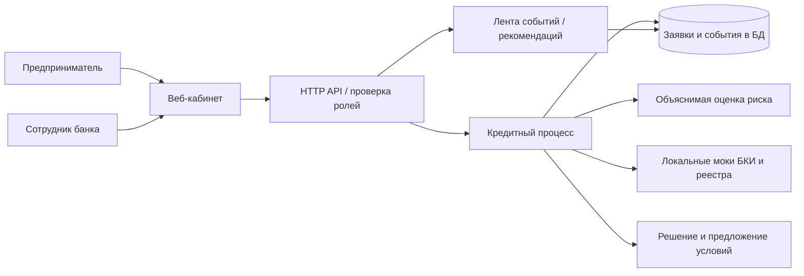

# Проект архитектуры MVP

Статус: **предложение**, код приложения ещё не реализован. Выбор фреймворков
фиксируется отдельным ADR с ресурсами команды, версиями и лицензиями.
Для трёх человек — модульный backend и одна реляционная БД, без обязательных
микросервисов и очередей. Все обязательные зависимости запускаются локально в Docker.

## Границы MVP

Выбор продукта, черновик, отправка, проверка полноты, запрос дополнений,
локальные проверки, расчёт риска, отдельное кредитное решение, результат в кабинете.
При положительном результате принятие условий и имитация подписи/выдачи.
Отказ и возврат на уточнение — отдельные проверяемые сценарии.
Интерфейс объясняет следующий шаг без банковского жаргона.

Скоринг возвращает оценку риска и факторы. Кредитное решение применяет правила
продукта/суммы/срока и результаты проверок; одинаковый риск не обязан давать
одинаковые условия. Формула синтетическая, не реальная модель банка.
LLM не нужна для основного пути. Если добавлять, только открытые веса и описанный
локальный режим; отсутствие модели не должно ломать кредитный путь.

## Надёжность и безопасность реализации

- Проверять роль и владельца заявки на сервере в каждом запросе; скрытый экран
  не является контролем доступа. Bank и customer разделены.
- Переход статуса, запись решения и событие аудита — одна транзакция.
- Для повторной отправки/решения — Idempotency-Key и optimistic version.
- Внешний mock имеет таймаут и управляемую ошибку; ошибка не приводит к одобрению.
- Данные сохраняются в Docker volume; рестарт не сбрасывает заявки.
- Health/readiness, структурированные логи с correlation ID без содержимого документов.
- Демо-аккаунты и seed только для APP_ENV=demo; нет настоящих платежей и ЭП.
- Приложения контейнеризованы, конфигурация через окружение, образы и зависимости
  закреплены, секреты не включаются в image.

Отказоустойчивость и масштабирование для MVP описываются честно: один локальный
узел не обеспечивает высокой доступности. Резервное копирование БД, HA и развёртывание
нескольких экземпляров — дальнейшее развитие, не свойство текущего каркаса.
