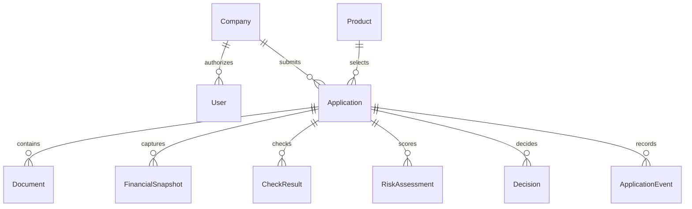

# Проект модели данных

Статус: реализация начата в `apps/api` (ветка/PR зоны данных). DDL — Alembic
`20261020_0001`; движок — PostgreSQL 16 (ADR-0002).

| Сущность | Основные поля | Ограничения |
| --- | --- | --- |
| User | id, role, company_id, demo_login, password_hash | customer/bank; пароли только hash |
| Company | id, synthetic_name, synthetic_registration_id | вымышленная организация |
| Product | id, name, min/max_amount, min/max_term, rules_version | версионируемые правила |
| Application | id, company_id, created_by, product_id, amount_minor, currency, term_months, purpose, state, version | FK; сумма integer в копейках, RUB |
| FinancialSnapshot | id, application_id, revenue_minor, expenses_minor, liabilities_minor, captured_at | неизменяемый snapshot для решения |
| Document | id, application_id, kind, storage_key, content_hash, synthetic | лимит/тип файла; доступ по владельцу |
| CheckResult | id, application_id, source, mock_version, result, checked_at | без реальных внешних запросов |
| RiskAssessment | id, application_id, score, factors, model_version | оценка риска, не решение |
| Decision | id, application_id, outcome, reason_codes, offered_terms, rules_version, actor_id | версия входных данных и правил |
| ApplicationEvent | id, application_id, actor_id, old_state, new_state, action, occurred_at, correlation_id | append-only на уровне приложения |
| IdempotencyRecord | actor_id, route, key, request_hash, response, expires_at | уникальность actor+route+key |

Деньги — целые копейки или точный decimal, не binary float. Времена — UTC,
в интерфейсе отображается понятный пояс. Чувствительные поля и файлы не пишутся
в HTTP-логи. Аудит продукта — отдельный от журнала Git; его ещё нужно реализовать.
Append-only на уровне приложения не защищает от администратора БД: для промышленного
аудита нужны независимое хранение/контроль целостности и отдельная модель доступа.
