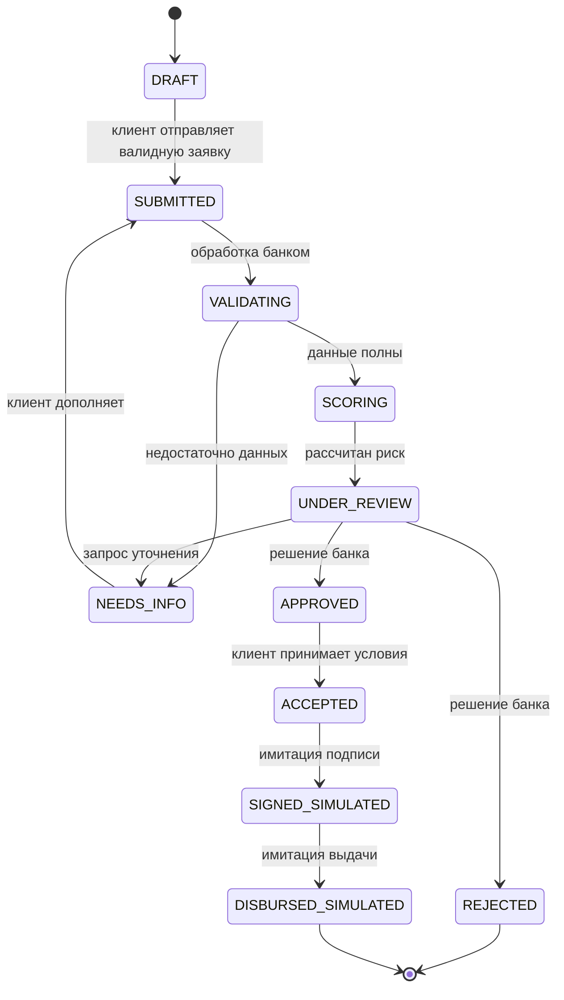

# Проект состояний заявки

Это контракт для будущей реализации, а не работающий процесс.

Проверка/скоринг могут завершиться технической ошибкой: состояние сохраняется,
записывается событие ошибки, доступен безопасный повтор. Ошибка не равна отказу
и не означает одобрение. Правила повторов и лимиты предстоит реализовать.
Альтернативные условия входят в предложение APPROVED с указанием отличий от заявки;
в MVP их должен принять клиент. Несанкционированный переход — 403,
недопустимый переход или устаревшая версия — 409. Каждый переход фиксирует роль,
старое/новое состояние, время UTC, correlation ID и версию заявки.
